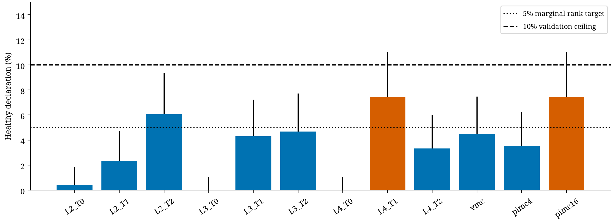
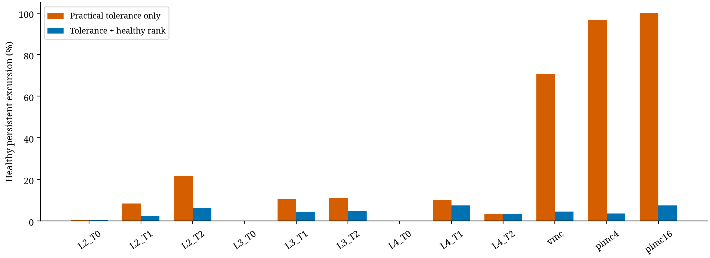

# Healthy calibration

|Cell|threshold|healthy events/512|simultaneous upper95|pass|
|---|---|---|---|---|
|ising_L2_T0|0.1|2|0.0184|True|
|ising_L2_T1|0.126744|12|0.0472|True|
|ising_L2_T2|0.134086|31|0.0938|True|
|ising_L3_T0|0.1|0|0.0106|True|
|ising_L3_T1|0.116184|22|0.0724|True|
|ising_L3_T2|0.122346|24|0.0772|True|
|ising_L4_T0|0.1|0|0.0106|True|
|ising_L4_T1|0.109569|38|0.1101|False|
|ising_L4_T2|0.1|17|0.0600|True|
|vmc|0.222758|23|0.0748|True|
|pimc4|0.561319|18|0.0625|True|
|pimc16|0.977593|38|0.1101|False|

H1 does not pass jointly:10/12 primary cells meet the frozen simultaneous-upper10% validation ceiling. L4/Tc and M16 PIMC each produced38/512 declarations, with upper.1101. No threshold was adjusted after confirmation. This does not contradict the marginal exchangeable rank result; a particular realized calibration can have a higher conditional alarm probability.

399 calibration and512 independent confirmation trajectories per cell. Thresholds control each observable over the complete specified finite run, not every possible horizon. Secondary observable results and raw practical-tolerance excursion rates are in calibration_analysis.json. The primary healthy rank target is5%; the10% ceiling is intentionally looser and must not be described as verified5% conditional control.

Primary calibration does not validate mixing or the nominal95% uncertainty intervals. In particular a broad healthy PIMC threshold may reflect poor information content; lower FPR alone is not sufficient sensitivity or utility.

References: [Vovk2012, marginal versus conditional validity](https://proceedings.mlr.press/v25/vovk12/vovk12.pdf), [Flegal & Jones on dependent-sample variance](https://arxiv.org/abs/0811.1729).

## Practical-tolerance limitation

The frozen tolerances are transparent engineering choices for this benchmark, not externally established safety limits: energy error 0.1 J per spin; VMC x² error 0.1 against mean 0.5 (20%); PIMC energy error 0.1 in m=ħ=ω=1 units. Their practical importance depends on a downstream use case. They were fixed before confirmation, but broader healthy rank thresholds can make an inaccurate sampler appear normal relative to its own protocol. Absolute accuracy, valid uncertainty and calibrated anomaly probability must therefore be assessed separately. No user-level safety or application-loss threshold has been established.
