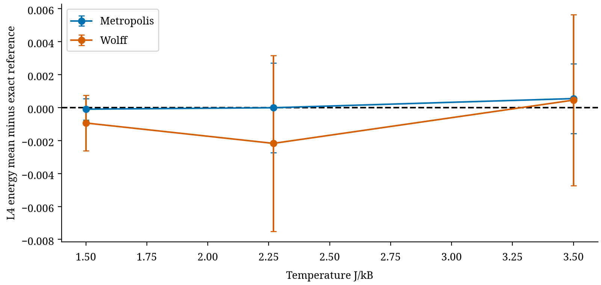

# Ising validation

|Cell|energy error|magnetization error|absolute-M error|susceptibility error|heat-capacity error|
|---|---|---|---|---|---|
|ising_L2_T0|-0.00018289|-0.0039972|3.4127e-05|-0.25331|-0.0009797|
|ising_L2_T1|0.00051799|-0.0096003|-0.00020477|-0.023151|-0.00023488|
|ising_L2_T2|-0.00095563|0.0014394|7.7197e-05|-0.0036332|-0.0005009|
|ising_L3_T0|-0.0007281|-0.018595|0.00019857|-3.206|-0.0030204|
|ising_L3_T1|-0.0020287|0.00060131|0.00070253|-0.11989|-0.0040145|
|ising_L3_T2|0.0010481|-0.00094181|-0.00046353|-0.008623|-0.00067154|
|ising_L4_T0|-9.6028e-05|0.017158|3.4982e-05|-9.6574|-9.7139e-05|
|ising_L4_T1|-9.3504e-06|0.0026406|9.6026e-05|-0.38508|-0.0031413|
|ising_L4_T2|0.0005458|-0.0033228|-0.00027403|-0.011887|-0.001638|

Periodic square lattices L2,L3,L4 at T1.5,Tc,3.5; J=kB=1. L2 periodic parallel bonds count twice consistently in reference and sampler. Exact enumeration covers all these finite systems; infinite-lattice Tc only marks a regime. References were independently reconstructed by explicit bond sums. Susceptibility uses signed M variance/(NT), heat capacity energy variance/(NT²); their finite-chain plug-in bias is retained. Within-chain coverage is checked only where the saved primitive observable admits the declared batch procedure; nonlinear response-observable confidence remains unvalidated.

2048 random-scan sweeps,512 burn-in,512-observation windows. Primary whole-path energy calibration fails at L4/Tc but passes in eight other Ising cells. Structural-bias arms are classified analytically; not used as ordinary stationary perturbation examples. Mild acceptance bias min(.02,.5exp(-8/T)) preserves positive transitions. Changing defect strength with T limits interpretation of critical vulnerability.

Near-critical excess-MSE contrasts and approximate multiplicity-adjusted intervals are in calibration_analysis.json. They favor near-Tc under this safety-rule defect design, but do not isolate an intrinsic criticality effect or establish a critical exponent. Three temperatures/small lattices cannot establish thermodynamic-limit scaling.

Exploratory cluster comparison uses8 separate pilot chains to freeze a fixed number of cluster operations, then32 new chains/temperature. It approximately matches expected flipped-spin work to32768 Metropolis attempted spins per chain. Samples are taken per fixed cluster operation; no state-dependent stopping-time sampling. Actual cluster flips,bond visits and wall times are saved. These are distinct cost units; vectorized Metropolis versus scalar Wolff timing is not an algorithmic speedup benchmark. Namespace hashes include temperature and replica, fixing v0.16 seed overlap.

Cluster energy means agree with exact finite-size references within their reported pointwise between-chain uncertainty. Failure thresholds calibrated for Metropolis are not transferred to Wolff; a complete cluster-specific false-alarm campaign is pending.

## Healthy susceptibility counterexample

At L4, T=1.5, the exact zero-field susceptibility is 10.403227. Across 512 healthy chains the within-chain plug-in estimate averaged 0.745828, a bias of -9.657399 (between-chain 95% interval [-9.859323, -9.455475]). Subtracting the squared finite-chain magnetization is severely misleading when chains do not sample both magnetized phases. Accurate energy does not validate this response observable. This is healthy finite-run mixing/estimator error, not evidence of defective randomness.

An exploratory known-zero-mean symmetry estimator, N times mean(m²)/T, averaged 10.403680, with bias interval [-0.003270, 0.004176]. It uses exact finite-lattice zero-field spin-flip symmetry; this is not a generic estimator repair or a proof of second-moment equilibration. The post-confirmation calculation reuses saved traces, does not change any registered endpoint, and is not new confirmation. All nine cells are in SUSCEPTIBILITY_PROBE.json. Susceptibility and heat-capacity interval calibration still require separate validation.
