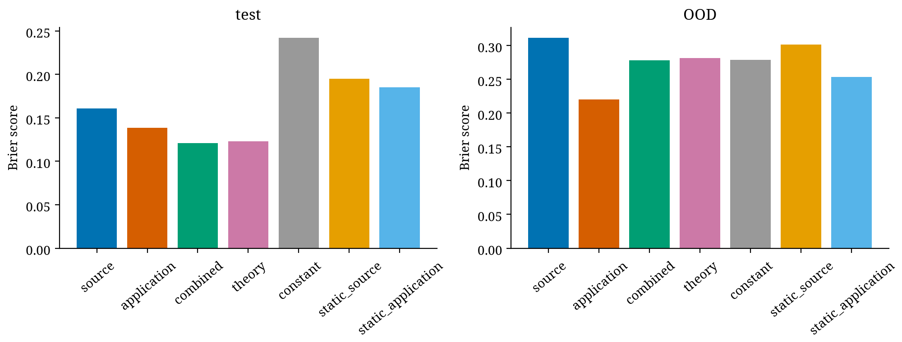
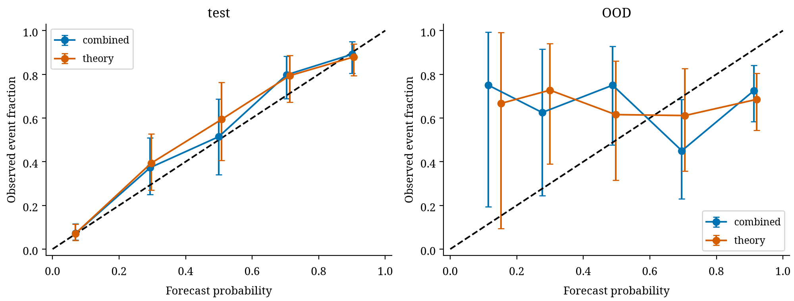
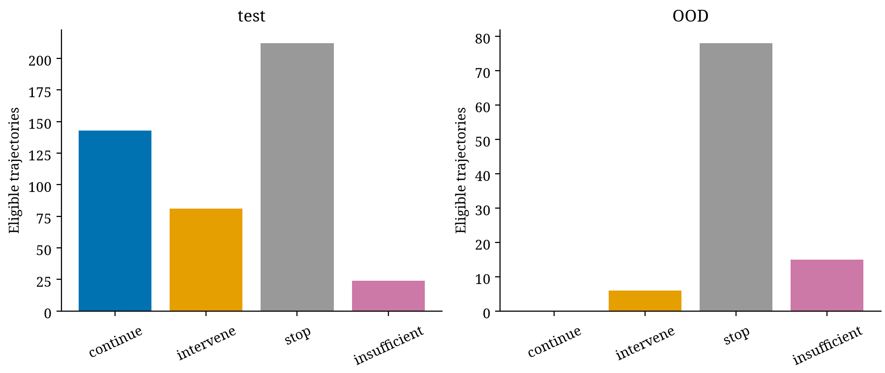

# Incident predictive reliability

|split|model|eligible|events|Brier|continue|cost:no mitigation|
|---|---|---|---|---|---|---|
|validation|source|233|90|0.145881|0|1.2356|
|validation|application|233|90|0.134186|0|1.2584|
|validation|combined|233|90|0.103148|69|0.97425|
|validation|theory|233|90|0.102603|70|0.97425|
|validation|constant|233|90|0.238854|0|1.0193|
|validation|static_source|233|90|0.184519|0|2.0408|
|validation|static_application|233|90|0.173294|0|2.3026|
|test|source|460|188|0.160615|0|1.5098|
|test|application|460|188|0.138406|0|1.293|
|test|combined|460|188|0.120784|143|1.1167|
|test|theory|460|188|0.123227|138|1.22|
|test|constant|460|188|0.242059|0|1.0157|
|test|static_source|460|188|0.194944|0|2.4265|
|test|static_application|460|188|0.185358|0|2.4374|
|OOD|source|99|66|0.311494|0|1.3293|
|OOD|application|99|66|0.220331|0|1.7101|
|OOD|combined|99|66|0.278261|0|1.5202|
|OOD|theory|99|66|0.281463|0|1.5202|
|OOD|constant|99|66|0.278912|0|1.0455|
|OOD|static_source|99|66|0.301602|0|2.7374|
|OOD|static_application|99|66|0.253605|0|2.798|

Forecasting was restricted a priori to L3/Tc energy, and this cell passed its own prespecified healthy gate. Global H1 still failed. Target: a NEW calibrated persistent excursion after cutoff1408 and by1920, given prefix information only. All paths observed through2048; no censoring before the horizon. Already-failed trajectories are counted separately. All abrupt trajectories failed before cutoff and contribute no incident forecast evaluation; the eligible known-family population is healthy plus gradual drift. OOD retained only93 periodic and6 correlated paths; the other413 OOD paths were already failed. This substantial selection prohibits whole-population generalization.

Development/validation/test/OOD base seeds are disjoint. One row per whole trajectory; features, normalization,static warning boundaries,regularization,primary candidate,decision thresholds and costs were fixed without test fitting. Logistic binary risk is a one-horizon discrete hazard; a multi-landmark survival model was not justified/implemented. It must not inflate replication by overlapping windows.

Source-only,application-only,combined,theory and calibrated static-warning risk tables are compared against development prevalence. Theory uses the inherited exact L3 stationary IID-bias response only on delta<=.025. Correlation/drift violate stationary assumptions; numerical domain checks do not prove those assumptions. No novelty claim is made for logistic forecasting.

Test combined Brier .12078 versus prevalence .24206; primary paired difference-.12127, approximate adjusted CI[-.14466,-.09616]. This is a genuine scoped proper-score improvement under the defined healthy/drift test population. Theory Brier .12323 is worse than combined and adds no demonstrated benefit. OOD combined .27826 versus constant .27891; difference-.00065, CI[-.08755,.09721], no demonstrated gain. Post-confirmation stratified bootstrap sensitivity preserves the same qualitative conclusions; see STRATIFIED_SENSITIVITY.json.

Four actions are implemented:continue,intervene,stop,insufficient evidence. Validation requires at least32 proposed continuations and a working one-sided95% upper risk<=.1 before permitting continuation. Support failures trigger review/stop; theory also checks its numerical perturbation range. Test combined policy continued143/460 paths, with4 subsequent events, and assigned81 interventions,212 stops,24 insufficient-evidence outcomes. OOD continued0/99. These quantities are conditional on incident eligibility. Binomial risk intervals are descriptive under the working mixture model, not distribution-free conditional guarantees across the fixed family strata or shifts.

Costs were specified:failure during continuation10,stop1,review+stop1.3,intervention.5 plus unchanged failure loss10. Under no empirically assumed mitigation, test combined mean cost1.117 exceeds always-stop1; thus the full H4 usefulness criterion fails despite better scoring and useful continuation count. Hypothetical50% intervention mitigation is a separate sensitivity output, not an observed intervention benefit. No restart/source repair experiment was performed.

H5 is unsupported: unseen-family scoring gain and useful continuation both fail. H4 supports prediction discrimination within a restricted population but not the predeclared combined score-and-utility hypothesis. Risk calibration,decision effectiveness and scientific causation remain separate.

## Warning, miss and lead-time diagnostics

| Population | Warning | True warnings | False warnings | Missed events | Median declaration lead (sweeps) |
|---|---|---:|---:|---:|---:|
| test | static_source_warning | 105 | 38 | 83 | 256.0 |
| test | static_application_warning | 106 | 31 | 82 | 256.0 |
| test | combined_risk_above_0.1 | 183 | 124 | 5 | 256.0 |
| test | combined_risk_at_least_0.3 | 164 | 59 | 24 | 256.0 |
| OOD | static_source_warning | 45 | 25 | 21 | 256.0 |
| OOD | static_application_warning | 46 | 17 | 20 | 256.0 |
| OOD | combined_risk_above_0.1 | 64 | 33 | 2 | 256.0 |
| OOD | combined_risk_at_least_0.3 | 59 | 31 | 7 | 256.0 |

Post-confirmation descriptive reductions at previously fixed boundaries; no optimization or new confirmatory tests. Test contains 188 events and 272 non-events; OOD contains 66 events and 33 non-events. Exact pointwise working binomial intervals and denominators are saved in WARNING_DIAGNOSTICS.json. These conditional mixture summaries do not provide distribution-free guarantees. The combined 0.1 boundary misses fewer test events but warns on 124/272 non-events; thresholds are not matched in false-positive probability. Do not claim a matched-FPR superiority from this table. All warnings are issued at sweep 1408. The reported 256-sweep median is time to a constructed two-window event declaration, with a 128–512 range among true warnings. Overlapping-window persistence creates mechanical lag: this does not establish 256 sweeps of usable warning before physical damage, successful mitigation, or an independent early-warning advantage. Support/abstention gates are applied in the separate four-action policy, not these raw alerts.
