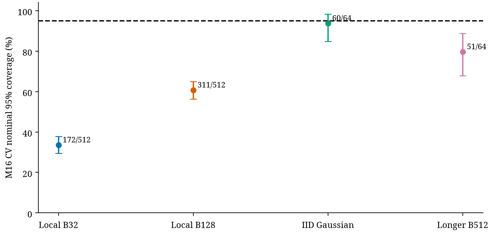

# Quantum-model recalibration

|Model|method|covered/n|Holm p|
|---|---|---|---|
|ising_L2_T0|batch32|468/512|0.008295|
|pimc4|batch32|336/512|3.778e-94|
|pimc4|batch128|434/512|8.011e-17|
|pimc16|batch32|172/512|5.181e-305|
|pimc16|batch128|311/512|2.993e-120|

VMC:alpha=.5,4096 steps,1024 burn-in. Energy is exactly.5; E[x²]=.5,E[x⁴]=.75. Position/higher moments show harmful proposal bias/coupling while energy remains blind. The x² whole-path calibration passes; constant energy IAT/ESS is undefined, not infinite evidence of quality.

PIMC:beta2,M4/16,4096 sweeps,1024 burn-in. Corrected inherited TD/CV definitions are preserved. Finite-bead references agree with an independent normal-mode precision spectrum for M4,8,16,32. Position x² targets the finite-M energy; centroid² targets.5. Full sequential traces allow reset/window versus cumulative inspection. Discretization toward the continuum is separate from Markov sampling uncertainty.

M16 CV coverage was172/512 with batch32 and311/512 with batch128, both rejected after the24-test Holm correction. This uncertainty was not supplied to forecasting training. M16 whole-path false-alarm validation also failed its ceiling. Broader anomaly thresholds do not repair these defects.

Exploratory exact Gaussian finite-bead IID controls give CV60/64 and TD62/64 coverage, with intervals containing nominal.95. A separate64-chain local-Metropolis control compares a short prefix to a longer12288-sweep run. For CV, longer-run coverage was21/64 (batch32),39/64 (batch128),51/64 (batch512). Increasing length without increasing effective block length does not cure undercoverage. These are matched repeated analyses of64 chains, not multiple independent confirmations. Length and burn-in change together, so initial bias and autocorrelation are not fully separated.

The contrast supports investigating long correlation scales/variance estimation rather than another energy-coefficient fix. It does not prove the exact causal decomposition; stationarity, diverse initial states and asymptotic interval validity remain open. Memory summaries and complete early/late series are in physics-controls/results.json and NPZ files.
