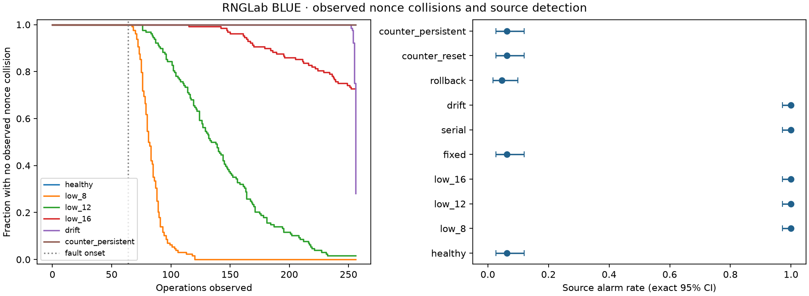
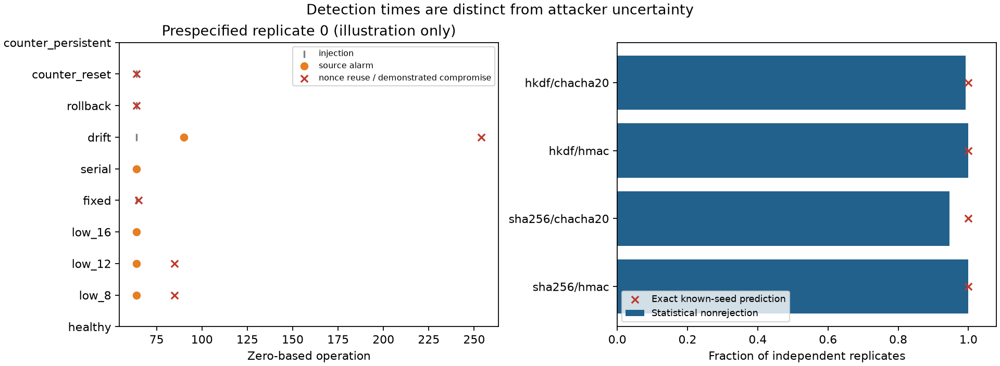

# RNGLab BLUE: findings from the initial validated pipeline

**A system can produce statistically plausible output while its randomness infrastructure makes it insecure. RNGLab detected some injected source failures before observed misuse, but this campaign does not establish general security-failure prediction.** The distinction depends on the primitive, use of randomness, attacker knowledge and fault layer.

Evidence: [reviewed confirmation](../../research/crypto-blue/confirmation-reviewed/RESULTS.md), [sensitivity study](../../research/crypto-blue/sensitivity-reviewed/RESULTS.md), [protocol](EXPERIMENT_PROTOCOL.md), [scientific review](SCIENTIFIC_REVIEW.md), [reproduction](REPRODUCE.md). These links include the requested condition/statistics/outcome/security/detection/mitigation matrix. Full per-replica outcomes, scores, censored event times, environment and SHA256 manifests accompany each report.

## Executed scope

The confirmation used 128 independent synthetic replica identifiers and 256 operations per nonce trajectory, with fault onset at operation 64. The planned sensitivity study used 64 new replica identifiers, 512 operations and onset 128. Calibration used 199 separate healthy paths in each study. Healthy/faulted paths were paired within a replica; AES-128-GCM, AES-256-GCM and ChaCha20-Poly1305 shared nonce paths and were not counted as independent collision repetitions.

Both studies executed bounded weak-seed search, four conditioning/expansion combinations, ten nonce/source conditions, signature misuse/deterministic controls, DRBG compromise/recovery and defensive controls. Reviewed campaign runtimes were 27.45 s and 18.60 s on this host, excluding plotting/packaging; these are observations, not performance guarantees. Their identical-seed replays are not additional independent evidence.

## Statistical appearance versus unpredictability

| Known 8-bit seed → conditioner → expander | Confirmation streams not rejected by three diagnostics | Exactly predicted streams |
|---|---:|---:|
| SHA256 → HMAC-DRBG | 128/128 | 128/128 |
| SHA256 → ChaCha20 | 121/128 | 128/128 |
| HKDF → HMAC-DRBG | 128/128 | 128/128 |
| HKDF → ChaCha20 | 127/128 | 128/128 |

Monobit, block-frequency and runs diagnostics used Holm correction within each stream at 1%. This is not the complete SP800-22 battery. The attacker model knows the seed and request schedule, making exact prediction possible regardless of a diagnostic outcome. Raw low-support seed screening alarmed; output screening usually did not.

The preregistered claim that nonrejection probability exceeds 90% was supported after four-cell Holm correction in three cells. **SHA256/ChaCha20 did not meet that criterion** (adjusted p=0.0509588); its CP95 interval was approximately 89.1–97.8%. The 64-replica sensitivity study had 63/64, 63/64, 64/64 and 64/64 nonrejections respectively and met its four-cell criteria. It does not retroactively change the first study's decision.

A separately labeled **post-hoc exhaustive audit** evaluated all 256 possible seeds for these fixed 4096-byte mappings. Nonrejections were 252, 250, 255 and 253 of 256 respectively. These finite-domain counts clarify the model and do not replace the registered sampling results. The independent review output records the rejected seed identifiers.

## Key generation and signatures

All 128 synthetic AES-256-GCM keys drawn from each of the 8-bit and 12-bit seed spaces were recovered by their deliberately bounded dictionaries. Mean attempts were 126.8 and 1980.1; mean duplicates among 64 generated keys were 7.06 and 0.59. The same seed duplication appeared in Ed25519 public keys. Known partial seed prefixes reduced the enumerated suffix space. Reinitializing from the same input reproduced the same key.

This demonstrates seed-space weakness, not AES key-space brute force. Analytically, deterministic conditioning cannot enlarge the number of possible keys beyond the seed support. For genuinely uniform b-bit unknown seeds, exhaustive candidate search takes up to 2^b attempts and mean (2^b+1)/2 in the simple model. No practical production-strength key recovery was attempted.

ECDSA nonce reuse recovered the synthetic P-256 private scalar in 128/128 confirmation cases; a signature on a new local message verified under the original public key. RFC6979 signing and Ed25519 both reproduced the same signature for the same message and behaved correctly on distinct messages, with independent RFC known-answer tests. Their deterministic signing protects against missing per-message entropy; it does not repair poor key-generation entropy.

## AEAD misuse and defensive controls

| Nonce/source condition | Confirmation collision paths | Sensitivity collision paths |
|---|---:|---:|
| Healthy reference | 0/128 | 0/64 |
| 8-bit nonce seed support | 128/128 | 64/64 |
| 12-bit support | 126/128 | 64/64 |
| 16-bit support | 35/128 | 45/64 |
| Downstream fixed nonce | 128/128 | 64/64 |
| Serial bit correlation | 4/128 | 10/64 |
| Gradual bit bias | 92/128 | 63/64 |
| DRBG state rollback | 128/128 | 64/64 |
| Counter reset | 128/128 | 64/64 |
| Shared persistent counter with restart | 0/128 | 0/64 |

On all 769 colliding confirmation paths, each AEAD disclosed the second synthetic plaintext through same-nonce keystream reuse with a known first plaintext. Both GCM variants additionally accepted a changed one-block message with a recomputed tag in all 769 cases. ChaCha20-Poly1305 integrity forgery was not attempted; its confidentiality failure is measured, while the integrity implication remains a standards-backed analytical statement. Fresh-nonce negative controls produced no XOR recovery and no accepted GCM forgery. Ordinary unaided bit flips were rejected even in the reused-nonce cases.

The per-key guard rejected every repeated candidate before encryption, with zero repeated emissions. The SQLite allocator had no observed reuse across simulated reopen events; concurrent-writer and exhaustion tests also passed. Unique counters can meet these nonce requirements without statistical randomness. Their safety depends on shared, trustworthy persistent state; snapshot rollback, independent ledgers and compromised keys remain outside that guarantee.

Raw source gating blocked misuse in the low-support, serial and drift paths in this experiment. It did not reliably stop downstream fixed nonces, rollback or counter resets. A few incidental/pre-fault quarantines prevented misuse by chance and are **not credited as successful source-fault warnings**. Downstream fixed/reset conditions preserve exactly the healthy raw bytes and alarms.

## Security stability windows and calibration limits

For eligible confirmation paths where both a post-fault source alarm and a later compromise were observed, median alarm-to-compromise intervals were 16 operations for 8-bit support (125 paths), 68 for 12-bit support (123), 131 for 16-bit support (35), and 160 for gradual drift (89). These are conditional descriptive observations; selection excludes censored paths and pre-fault alarms. They are not universal safe operating windows or calibrated prediction intervals.

The raw monitor alarmed on 8/128 healthy confirmation paths: 6.25%, CP95 approximately 2.7–11.9%. **The frozen requirement that this upper bound be at most 10% was not met.** The sensitivity study had 0/64 healthy alarms (upper bound 5.6%) and met that scoped check at its different horizon/calibration. No threshold was retuned, and the two decisions are reported separately.

Counter reset and DRBG rollback produced nonce misuse at onset. The first fixed nonce created a collision at the following operation. Neither mechanism supplied a reliable raw-source warning. A known key seed is theoretically insecure from the time it becomes known, before any observed collision. Conversely, predictable but unique counter nonces are acceptable in these constructions. Source predictability, key predictability and nonce reuse cannot share one undifferentiated “failure time.”

The saved KM curves retain right-censoring and do not extrapolate tails. Exact common-horizon binomial intervals quantify event rates. Under the explicitly IID uniform support model, analytical post-fault collision probabilities for 192 draws are about 98.94% at 12 bits and 24.43% at 16 bits, consistent with the observed uncertainty intervals. A full finite-domain audit verified that the implemented truncated SHA256 nonce map is injective on all three toy supports. These formulas do not describe arbitrary drift, correlation or resets.

## Reseeding and operational cost

In every confirmation case, a known-state clone continued predicting after a known all-zero reseed. A restored model input withheld from the clone changed future output and rejected its guessed rekeyed ciphertext, but old ciphertext remained decryptable with the old compromised key. An initially unknown retained DRBG state was not made predictable merely by mixing a known reseed. These are measured clone outcomes; actual source independence and conditional entropy remain assumptions.

Startup/reseed budget checks blocked unknown/zero entropy evidence; starvation returned no replacement bytes; quarantine required explicit adequate recovery evidence. The policy does not infer entropy from seed length, passing health tests or a claimed assessment label.

A separate 12-repeat, 256-operation microbenchmark observed median AES256-GCM cost around 0.601 microseconds/operation, guarded AEAD 0.796 microseconds, vectorized source scoring 0.577 microseconds/block, and durable SQLite reservation 50.95 microseconds/allocation. Startup was excluded and conditions alternated order. These single-host timings have no independent-machine uncertainty claim; batch scoring is not a streaming-latency benchmark. Guard capacity and blocked-operation counts are recorded separately.

## What has and has not been established

Validated regression facts include published cryptographic vectors, actual synthetic plaintext/key recovery, library-accepted GCM forgeries under violated nonce requirements, fresh-nonce negative controls, deterministic replay and unchanged legacy tests. Mathematical derivations explain why seed support and nonce/signature misuse cause the measured effects.

Physical cryptographic entropy, practical attacks against production-sized secrets, ChaCha integrity forgery, Hash/CTR-DRBG alternatives, distributed rollback-proof allocation and general failure forecasting are **not validated here**. The physical importer is implemented and fixture-tested, but the original detector data and necessary measurement metadata are unavailable.

The experimentally grounded answer is therefore conditional: **statistical health can coexist with insecurity; some visible raw-source deterioration permits intervention before observed misuse, while hidden seed knowledge and downstream state/API faults can defeat source-only detection. RNGLab can measure these distinctions and test scoped prevention, but this initial campaign supports no universal advance-warning guarantee.**
