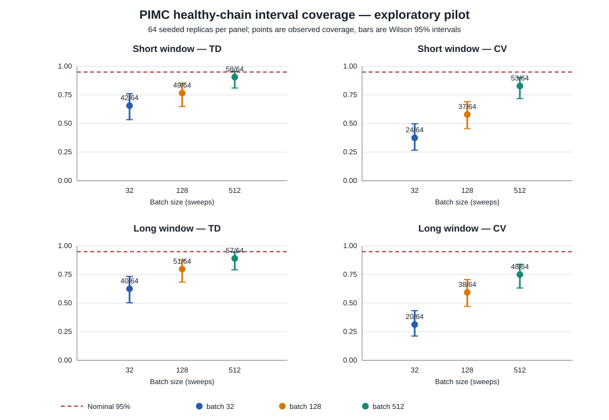

# PIMC uncertainty pilot: method and results

**Date:** 30 October 2026  
**Classification:** exploratory pilot; not confirmatory  
**Purpose:** independently check whether the documented undercoverage in the harmonic-oscillator PIMC control is reproducible, and whether longer batch sizes improve it.

## Question and scope

For the finite-bead harmonic oscillator at (M=16), β=2, does a nominal 95% non-overlapping batch-means interval cover the exact finite-bead energy at the expected rate under RNGLab's local Metropolis update? Compare batch sizes 32, 128 and 512 sweeps for the thermodynamic (TD) and centroid-virial (CV) estimators.

This is a **healthy-source sampler control**. It asks whether the uncertainty estimate is reliable for this MCMC workload; it does not test degraded random-number sources and cannot attribute any undercoverage to RNG defects.

## Implementation

The pilot script is [pimc_uncertainty_pilot.py](pimc_uncertainty_pilot.py). It uses Python's standard library because NumPy, SciPy and pytest are absent from the available runtime. It independently reimplements the transition and estimators in the repository's [`rnglab16/core.py`](https://github.com/robinator121/rngLABexperimental/blob/dd96adba23b8100aba9147d71fffc63932fc6b0d/src/rnglab16/core.py) and [`rnglab14/models/pimc_harmonic.py`](https://github.com/robinator121/rngLABexperimental/blob/dd96adba23b8100aba9147d71fffc63932fc6b0d/src/rnglab14/models/pimc_harmonic.py). It is not a run of those NumPy/SciPy modules.

- 64 replicas; 12,288 sweeps per replica; 16 beads; β=2; proposal width 0.4.
- Start each bead uniformly on [-0.5, 0.5). Visit beads in fixed order; use a symmetric local proposal and Metropolis acceptance.
- Give each replica its own deterministic `random.Random` stream. Its seed is the first 128 bits of SHA-256 over a fixed namespace and replica index. This ensures replayability and distinct seeds, not mathematical independence or physical entropy.
- Record TD and CV energy after every sweep. Preserve the full traces in the compressed CSV file.
- Compare two disjoint time windows from each trajectory: sweeps 1,025–4,096 (3,072 retained) and sweeps 4,097–12,288 (8,192 retained). These differ in both burn-in and observation length; they do not identify a burn-in effect.
- For each window, average consecutive non-overlapping blocks, calculate a Student-t interval across block means, and check coverage against the finite-bead reference. Wilson intervals describe the uncertainty in the observed fraction of covered chains.

The exact finite-bead reference is

\[
E_M(\beta)=\frac{1}{2\tanh\!\left(M\,\operatorname{asinh}(\beta/(2M))\right)\sqrt{1+(\beta/(2M))^2}}.
\]

At these settings it is **0.6554741523**. The continuum limit is 0.6565176427; using the latter as the M=16 target would mix discretization error with sampling error. The script checks the finite-bead result against a central finite difference of the log partition function; the absolute difference is (1.9\times10^{-11}). It also checks the Student-t quantiles used in all intervals.

## Results

| Window | Estimator | Batch | Covered | Coverage | Wilson 95% interval |
|---|---:|---:|---:|---:|---:|
| 1,025–4,096 | TD | 32 | 42/64 | 65.6% | 53.4–76.1% |
| 1,025–4,096 | TD | 128 | 49/64 | 76.6% | 64.9–85.3% |
| 1,025–4,096 | TD | 512 | 58/64 | 90.6% | 81.0–95.6% |
| 1,025–4,096 | CV | 32 | 24/64 | 37.5% | 26.7–49.7% |
| 1,025–4,096 | CV | 128 | 37/64 | 57.8% | 45.6–69.1% |
| 1,025–4,096 | CV | 512 | 53/64 | 82.8% | 71.8–90.1% |
| 4,097–12,288 | TD | 32 | 40/64 | 62.5% | 50.3–73.3% |
| 4,097–12,288 | TD | 128 | 51/64 | 79.7% | 68.3–87.7% |
| 4,097–12,288 | TD | 512 | 57/64 | 89.1% | 79.1–94.6% |
| 4,097–12,288 | CV | 32 | 20/64 | 31.3% | 21.2–43.4% |
| 4,097–12,288 | CV | 128 | 38/64 | 59.4% | 47.1–70.5% |
| 4,097–12,288 | CV | 512 | 48/64 | 75.0% | 63.2–84.0% |



The project report's earlier long-window CV results were 21/64, 39/64 and 51/64 at the same batch sizes. This independent scalar replay yielded 20/64, 38/64 and 48/64. The close counts and the same monotone improvement with larger batches are encouraging reproducibility evidence for the *qualitative* pattern; the run is not bit-for-bit or code-path replication.

For the long CV window, average chain estimates were 0.652846, while the reference was 0.655474. Coverage increased as blocks got longer, but remained 75% at batch 512; its 95% Wilson interval ended at 84%. The long-window TD estimator also remained below nominal coverage at all three batch sizes. Thus neither a point estimate near the answer nor longer chains by themselves validate the uncertainty interval.

The short-window batch-512 comparison has only six batches. This exploratory script permits four or more blocks, matching the project's separate calibration-control helper; the general series summarizer requires eight and would abstain on this specific row. The long-window batch-512 result has 16 blocks and is unaffected by that difference.

## Interpretation and limitations

The pilot supports the project's decision to address healthy-sampler uncertainty before making stronger claims about monitoring, degraded RNGs or forecasting. Dependence inside the Markov chain can make short-block uncertainty estimates under-cover even when the random stream is intended to be healthy. It is therefore essential to distinguish sampler mixing and interval calibration failures from RNG-source failures.

The Wilson intervals are wide because there are only 64 chains. All methods and both windows reuse the same replicas, so between-row comparisons are correlated. Starting conditions and burn-in were not separated from retained length. No stationary-start or exact-IID control was run in this pilot; the project's earlier report documents such an IID control, but its source arrays are not present in the current public repository. No confirmatory holdout or acceptance margin was registered before the run.

The current RNGLab batch-means and Geyer estimators explicitly state that stationarity, mixing, reversibility and batch-size adequacy are not established by those summaries. That caution is well grounded in MCMC variance-estimation literature ([Geyer, 1992](https://doi.org/10.1214/ss/1177011137); [Flegal & Jones, 2010](https://doi.org/10.1214/09-AOS735)).

## Reproduction

From the outputs directory, run:

```bash
python3 pimc_uncertainty_pilot.py
```

The script writes [JSON results](pimc-uncertainty-pilot-results.json), [per-replica seed and acceptance summary](pimc-uncertainty-pilot-chain-summary.csv), [full sweep-level traces](../phase2-20261030/DATA_AVAILABILITY.md#omitted-large-and-local-artifacts), and the SVG figure beside itself. It records Python/platform versions and the seed namespace in the JSON file. It takes about 26 seconds in the runtime used for this run.

I reran the pilot with the same script and namespace. Coverage values matched, and the trace, chain-summary and SVG files were byte-identical. Their SHA-256 hashes are:

- Trace archive: `d465471c7d97c39c6571e4f37c5e4474511864c63a736605b08544996205d005`
- Chain summary: `43b93950f1f3a48d4b694cf22b389df71c32809ce8c29ce34fea6d1d7f532e27`
- Coverage figure: `48cd0de5e89c9093b9fd930121dc81dfad649ceb6881d0e209dafc0d22591151`

The JSON's elapsed-time field varies between executions; the numerical coverage, trace, seed and figure outputs are deterministic in this runtime.

## Next confirmatory run

Keep the model and reference fixed, then vary one cause at a time. First reproduce an independent exact-Gaussian finite-bead control and increase the number of independent chains (for example, 512 per prespecified cell). Separately vary initialization, burn-in and retained length, with sufficient blocks for each interval method. Freeze one primary estimator and coverage endpoint; leave other block sizes and the second estimator as secondary analyses. After the healthy interval method is calibrated, inject one specified source fault and compare application bias and coverage against healthy chains under the same model, seeds, run lengths and measurement policy. Preserve every trace, manifest, code commit and analysis output.
