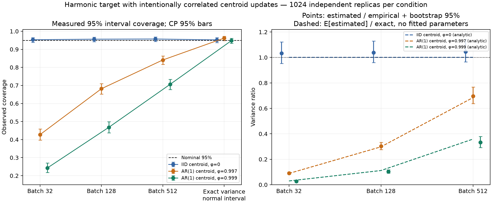
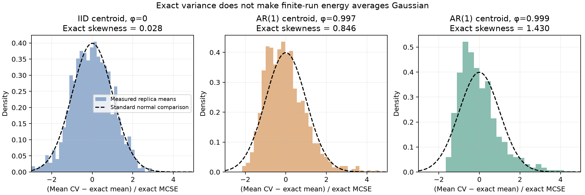

> Publication note: this is the completed local experiment report. Statements about files not yet pushed or an isolated patch describe that run before publication. The repository now includes the optional patch. Full raw traces are not distributed; see [data availability](../DATA_AVAILABILITY.md).

# Analytically solvable harmonic-target dependence control

Executed 2026-10-30. This supplementary Phase II experiment changes the **transition dynamics** while retaining the exact finite-M harmonic target. It is a synthetic mathematical control; it injects no random-number-source fault and does not claim that the local Metropolis centroid is exactly AR(1).

The experiment generated **3072 independently seeded trajectories**, 1024 per condition, each with 8192 retained CV observations. All starts were stationary. The main generation and analysis took **17.39 seconds** on the available CPU, using the Phase II isolated Python environment, one process and one BLAS thread. The new analytic regression suite passed **4 tests in 3.14 seconds**. Full CV traces and per-replica seeds are preserved.

## Construction and exact predictions

The primitive harmonic target is the same M=16, β=2 Gaussian path distribution as the main study. Write x=c1+y, where Σy=0. Its density factorizes into c∼N(0,1/β) independently of the internal modes. The centroid virial observable is

\[
 E_{CV}=\frac1{2\beta}+\frac12c^2+r_g^2,
 \qquad r_g^2=\frac1M\sum_j y_j^2.
\]

The centroid starts with its exact stationary normal distribution and follows

\[
 c_t=\phi c_{t-1}+\sqrt{(1-\phi^2)/\beta}\;Z_t,
 \qquad \phi\in\{0,0.997,0.999\}.
\]

At every step, all internal harmonic modes are independently redrawn. Their eigenvalues are
\(q_k=\beta/M+4M\sin^2(\pi k/M)/\beta\), so the shape observable can be generated exactly as
\(r_g^2=\sum_{k=1}^{M-1}Z_k^2/(Mq_k)\).
This avoids an unnecessary coordinate matrix multiplication while retaining the full internal Gaussian law. The repeated sine/cosine eigenvalues represent distinct independent real modes. Normal-mode sampling and collective treatment of harmonic coordinates have established PIMC precedents; this control does not propose a new sampling algorithm ([Moustafa and Schultz, 2024](https://doi.org/10.1021/acs.jctc.4c00522)). The CV estimator's fluctuation-coordinate derivation is also established ([Yamamoto, 2005](https://arxiv.org/abs/physics/0505109)).

At this target,

\[
 \mu=0.6554741522981734,\quad
 v_c=\operatorname{Var}(c^2/2)=0.125,\quad
 v_s=\operatorname{Var}(r_g^2)=0.00963144466744617.
\]

The CV autocovariance is known exactly:

\[
 \gamma_0=v_c+v_s=0.13463144466744617,
 \qquad\gamma_k=v_c\phi^{2k}\quad(k>0).
\]

Therefore the finite-n Monte Carlo variance is

\[
 V_n=\frac1{n^2}\left[n(v_c+v_s)+2v_c\sum_{k=1}^{n-1}(n-k)\phi^{2k}\right].
\]

For B=n/b nonoverlapping batches of size b, the usual MC-variance estimate is s²(batch means)/B. Its exact finite-n expectation is

\[
 \mathbb E[\widehat V_{BM,b}]=\frac{V_b-V_n}{B-1}.
\]

This identity includes covariance between batches; it does not assume independent batch means. Its independent dense-covariance regression test passed. General batch/spectral variance theory explains why increasing the number of fixed short batches does not automatically estimate the long-run variance ([Flegal and Jones, 2010](https://doi.org/10.1214/09-AOS735)).

The finite-run mean is not automatically Gaussian. With Rφ the temporal centroid correlation matrix,
\(\operatorname{tr}(R_\phi^3)=n+6\sum_{k=1}^{n-1}(n-k)k\phi^{2k}\).
Gaussian quadratic-form cumulants then give the exact skewness of the mean shown below. Dense small-matrix checks independently validated this formula.

| φ | Exact Var(mean CV) | Exact mean skewness | E[BM32 variance]/Vₙ | E[BM128 variance]/Vₙ | E[BM512 variance]/Vₙ |
|---:|---:|---:|---:|---:|---:|
| 0 | 0.0000164345025229 | 0.02833 | 1.0000 | 1.0000 | 1.0000 |
| 0.997 | 0.00497665118867 | 0.84578 | 0.0888 | 0.2978 | 0.6846 |
| 0.999 | 0.0143219482496 | 1.42980 | 0.0297 | 0.1116 | 0.3586 |

These are mathematical predictions fixed before the generated results, not fitted autocorrelation models.

## Measured coverage

Batch-mean intervals use the Student-t critical value with B−1 degrees of freedom. The oracle comparison uses the exact Vₙ and the standard normal 97.5% quantile. Oracle intervals know the correct variance but still use a distributional approximation. All reported uncertainty intervals on coverage are exact Clopper–Pearson 95% intervals across independent trajectories.

| φ | Method | Coverage count | Coverage | CP 95% interval |
|---:|---|---:|---:|---:|
| 0 | BM32 | 976/1024 | 95.31% | 93.83–96.52% |
| 0 | BM128 | 979/1024 | 95.61% | 94.16–96.78% |
| 0 | BM512 | 980/1024 | 95.70% | 94.27–96.86% |
| 0 | Exact variance, normal interval | 975/1024 | 95.21% | 93.72–96.44% |
| 0.997 | BM32 | 438/1024 | 42.77% | 39.72–45.87% |
| 0.997 | BM128 | 698/1024 | 68.16% | 65.21–71.01% |
| 0.997 | BM512 | 861/1024 | 84.08% | 81.70–86.27% |
| 0.997 | Exact variance, normal interval | 985/1024 | 96.19% | 94.83–97.28% |
| 0.999 | BM32 | 249/1024 | 24.32% | 21.72–27.06% |
| 0.999 | BM128 | 479/1024 | 46.78% | 43.69–49.89% |
| 0.999 | BM512 | 723/1024 | 70.61% | 67.71–73.38% |
| 0.999 | Exact variance, normal interval | 971/1024 | 94.82% | 93.28–96.10% |



The figure's variance points use measured mean estimated variance divided by the measured variance of replica means. Its dashed lines use the exact expectation divided by exact Vₙ; those denominators differ because the empirical variance is itself uncertain.

## Numerical agreement with the exact predictions

All nine measured mean BM-variance estimates were within **1.83 empirical standard errors** of their exact expectations. Their measured/expected ratios ranged from **0.9821 to 1.0171**. The implementation therefore reproduces the severe underestimation predicted by the known stationary model. It does not require an incorrect energy reference, initialization transient, or defective PRNG.

The empirical/true replica-mean variance ratios were:

| φ | Empirical Vₙ / exact Vₙ | Replica bootstrap 95% interval |
|---:|---:|---:|
| 0 | 0.9724 | 0.8945–1.0527 |
| 0.997 | 0.9682 | 0.8611–1.0762 |
| 0.999 | 1.0908 | 0.9164–1.3112 |

The larger uncertainty at φ=0.999 is consistent with a strongly skewed distribution of trajectory means. All empirical mean-bias confidence intervals included zero. Exact mean skewness is 0.0283, 0.8458 and 1.4298 respectively; the observed replica-mean skewness was −0.0310, 0.8608 and 1.7864. The last estimate illustrates that 1024 replicas still leave material uncertainty about high moments.



The normal oracle's coverage intervals all include 95%. This is evidence of coverage compatible with the target in these three conditions, not proof that the finite-run mean is normal. In particular, the known positive skewness remains substantial under slow centroid updates.

## Secondary diagnostic: average variance underestimation does not determine coverage alone

After inspecting the main results, a deterministic diagnostic reused the same saved trajectories and replaced every noisy BM512 variance estimate by its exact expected value, while retaining the same t₁₅ critical value. This diagnostic was **post hoc**, is separately labeled in its JSON output, and is not a new independent experiment.

| φ | Actual BM512 intervals | Fixed exact expected BM512 variance, same t₁₅ | Exact Vₙ, same t₁₅ | Exact Vₙ, normal quantile |
|---:|---:|---:|---:|---:|
| 0 | 980/1024 | 990/1024 | 990/1024 | 975/1024 |
| 0.997 | 861/1024 | 966/1024 | 996/1024 | 985/1024 |
| 0.999 | 723/1024 | 886/1024 | 980/1024 | 971/1024 |

The mean variance estimate alone does not predict interval coverage. Noisy per-trajectory estimates and their relationship with the energy error matter. For φ=0.997, BM512 missed entirely below the target on 152 trajectories and entirely above it on 11; for φ=0.999 the counts were 255 and 46. The correlation of estimated variance with trajectory mean was 0.773 and 0.843 respectively. These are measurements of joint behavior, not an independent causal decomposition. Replacing the random variance by its expectation directly demonstrates the consequence of changing that part of the interval construction on these data. The t approximation's independent-normal-batch rationale does not hold for these short dependent batches.

## What is established and what is not

This exact stationary control establishes that a healthy PRNG and a mathematically correct harmonic target can produce large BM undercoverage solely through intentionally specified transition dependence and the resulting finite-run interval behavior. The measured BM-variance expectations agree closely with exact theory. The correct finite-n variance yields normal intervals compatible with 95% coverage in the tested cases. Together with the main exact-start Metropolis and centroid-refresh comparison, this supports investigating centroid-driven dependence as a major contributor in RNGLab.

It does not identify an exact AR(1) model for Metropolis, prove that average variance underestimation is its sole failure mechanism, establish normality, validate an arbitrary batch choice, or demonstrate RNG degradation. It also makes no monitor or RUS forecasting claim. The independent-root Metropolis experiments are required to connect this known mechanism to that actual update rule.

## Reproduction and evidence

Use the Phase II environment recorded in `../environment/requirements-lock.txt`. To reproduce into a clean versioned directory, copy `analytic_dependence.py`, `test_analytic_dependence.py` and `analyze_and_plot.py` there. The script writes into its own directory and refuses to overwrite an existing `results.json`.

```sh
python -m pytest test_analytic_dependence.py -q --junitxml=analytic-tests.xml
python analytic_dependence.py --run
python analyze_and_plot.py
```

The executed interpreter was `LOCAL_WORKSPACE/work/phase2-env/venv/bin/python` (CPython 3.14.7), with NumPy 2.5.3, SciPy 1.18.1 and Numba 0.68.1. No fastmath option is used. The main protocol and script checksum were written before trajectory generation. This is a locally fixed protocol, without external preregistration or a blinded custodian.

Each condition has a manifest containing all 1024 per-replica SHA256-derived seeds, role separation, parameters, versions and trace checksum. All 3072 replicas use distinct condition/replica/role namespaces. Independence is the conventional PCG64 stream assumption, not a mathematical consequence of hashing. Per-condition CV arrays are saved in compressed NPZ files. `replica_endpoints.csv` preserves means, estimated variances and coverage events. `results.json` and `summary.csv` contain exact predictions, measured values and uncertainty intervals. `secondary_fixed_width_diagnostics.json` clearly labels the post-hoc checks. `analytic-tests.xml`, `execution.log`, `manifest.json` and `SHA256SUMS` preserve validation and integrity evidence.
