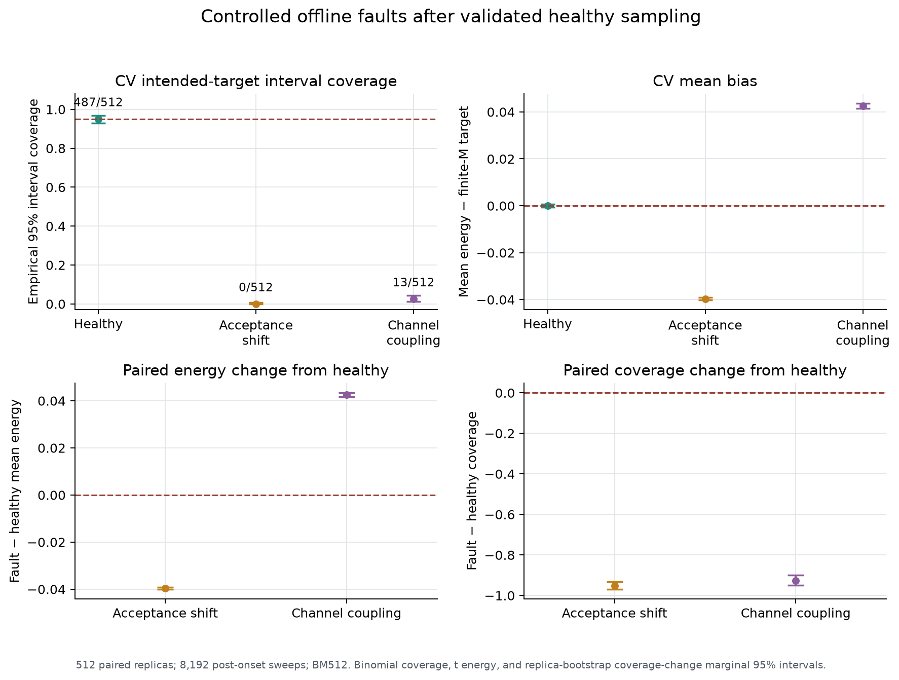

> Publication note: this is the completed local experiment report. Statements about files not yet pushed or an isolated patch describe that run before publication. The repository now includes the optional patch. Full raw traces are not distributed; see [data availability](../DATA_AVAILABILITY.md).

# RNGLab Phase II: controlled random-input faults

30 October 2026 · completed experiment `fault-study-v1`

## Result and scope

Both injected faults cause large additional energy bias and loss of intended-target interval coverage relative to the independently validated healthy centroid-refresh sampler. Good agreement between estimated and empirical variance does **not** protect an interval from sampling the wrong distribution.

The monitor comparison gives no general application-aware advantage. A marginal source-mean check detects acceptance bias but misses channel coupling; a joint source check detects coupling. The selected application-shape monitor detects much of the coupling fault, generally later, and misses acceptance bias. These are results for named rules and strong specified faults, not a comparison with a full randomness-test battery.

## 1. Frozen design and actual execution

The healthy experiment first passed the frozen independent 1,024-replica gate described in the [root-cause report](PIMC_root_cause_report.md). Only then was this fault protocol frozen, before calibration/test trajectories were generated. Its SHA-256 is `72ede91d8c4e82caa0454e4d50351272ee26a9e9b161bf4f694bc2c7f70614a1`. Runtime checks enforce the code hashes and healthy-decision hash/status.

The target remains the M=16, β=2 primitive harmonic path distribution, E_M=0.655474152298174. Every condition uses δ=0.4 local Metropolis plus a healthy independent exact-centroid refresh, with exact stationary initialization. All runs contain 10,240 sweeps. The first faulty input occurs at **sweep 2,049**. Energy analysis uses the 8,192 post-onset sweeps 2,049–10,240; the primary interval remains CV BM512 with t₁₅.

Calibration uses 399 healthy trajectories. Final evaluation uses 512 paired replica indices in each of three conditions, with distinct calibration/test namespaces. Initial, local-input, centroid and scan seeds match within a test replica across conditions. Every proposal consumes two random inputs regardless of acceptance; arithmetic workloads and stream positions are aligned. Each faulty replica's complete raw and source-statistic records are byte-identical to healthy for the first 2,048 sweeps, independently verified across all 512 replicas. Different conditions are paired observations, not 1,536 independent replica indices.

The faults are explicit offline adapters after healthy random generation:

| Condition | Post-onset mapping | Channel and defect |
|---|---|---|
| Healthy | Unchanged independent proposal and acceptance uniforms | Intended healthy PRNG model |
| Acceptance bias | `u_accept=min(u_accept+0.08,nextafter(1,0))` | Acceptance only; upward shift and clipping, including an atom near one |
| Channel coupling | `u_accept=u_proposal` | Acceptance shares the proposal input; individual margins remain uniform, joint independence is violated |

The centroid source stays healthy. These are **adapter-induced input faults**, not discovered intrinsic defects in PCG64. The second condition is cross-channel dependence, not a temporal-correlation experiment. The design prioritizes two precisely specified, strong faults and does not estimate a severity-response curve. No physical data, detector validation, HPC service or live instrument is involved.

## 2. Energy, uncertainty and incremental effects

| Condition | CV mean bias versus intended E_M, 95% interval | CV coverage, exact 95% interval | Estimated / empirical variance, bootstrap 95% interval |
|---|---|---|---|
| Healthy | −0.0000237, −0.000712 to +0.000664 | 487/512 = 95.12%, 92.88–96.82% | 1.024, 0.900–1.191 |
| Acceptance bias | −0.039610, −0.040133 to −0.039087 | 0/512 = 0%, 0–0.72% | 1.047, 0.922–1.191 |
| Channel coupling | +0.042502, +0.041468 to +0.043536 | 13/512 = 2.54%, 1.36–4.30% | 0.932, 0.823–1.070 |

Paired incremental effects relative to the same-seed healthy run are:

| Fault | Paired energy change, t-based 95% interval | Paired coverage change, bootstrap 95% interval |
|---|---|---|
| Acceptance bias | −0.0395864, −0.0399865 to −0.0391864 | −95.12 percentage points, −96.88 to −93.16 |
| Channel coupling | +0.0425256, +0.0416637 to +0.0433875 | −92.58 percentage points, −94.92 to −90.04 |

These ordinary marginal intervals quantify effect sizes; they are not familywise-adjusted simultaneous confidence statements. The large changes are incremental fault effects in a healthy-calibrated workload, unlike the earlier local-sampler baseline failure.

The shape mean r_g² is 0.155562 healthy, 0.115975 with acceptance bias and 0.198087 with coupling, against its intended target 0.155474. Corresponding TD means are 0.653706, 1.567082 and −0.440116. TD's negative faulty value is an estimator evaluated on a wrong distribution, not a negative physical energy finding. Both faulty TD intervals cover E_M in 0/512 runs. These estimator disagreements provide an additional application consistency diagnostic, but were secondary and were not used to retune the frozen alarms.

Fault post-onset averages include the transition after intervention; no stationarity of the faulty law is asserted. Their variance ratios describe reproducibility of these finite-run averages. They do not certify sampling of the intended physical target.

## 3. Source diagnostics and whole-run false alarms

Each rule uses a 1,024-sweep rolling window, stride 256. Per-sweep source records average over 16 consumed proposal/acceptance pairs. The scores are:

- **Marginal mean:** maximum absolute deviation of proposal or acceptance window mean from 0.5.
- **Cross-channel:** absolute window average of `(u_proposal−0.5)*(u_accept−0.5)`.
- **Application shape:** absolute window-mean r_g² deviation from its finite-M target.

For each monitor, its threshold is the 380th order statistic of 399 independent healthy **whole-trajectory maximum scores**, with strict `>` comparisons. Under exchangeability, the rank rule gives at most 5% whole-run false alarms **marginally over calibration and a new healthy path**, including all rolling looks; it does not guarantee that probability conditional on one realized threshold. Thresholds were saved after calibration and before test generation. The target is separate for each monitor; applying all three is not a combined 5% policy. Final healthy test rates and exact binomial intervals are measured, not assumed equal:

| Monitor | Threshold | Healthy false alerts /512, exact 95% rate interval | Acceptance-bias whole-run alerts /512 | Coupling whole-run alerts /512 |
|---|---:|---|---:|---:|
| Marginal mean | 0.00771548 | 15 = 2.93%, 1.65–4.79% | 512 | 7 |
| Cross-channel | 0.00208665 | 12 = 2.34%, 1.22–4.06% | 20 | 512 |
| Application shape | 0.07589438 | 24 = 4.69%, 3.03–6.89% | 4 | 447 |

All healthy upper bounds meet the prespecified ≤10% screening gate. Actual rates differ, so this is a shared nominal whole-run calibration budget, not an exactly matched realized-FPR superiority experiment. Fault alert intervals and paired alert-rate differences are retained in `monitor_results.json` and `paired_alarm_effects.json`.

Post-onset source means corroborate the injected mappings:

| Condition | Proposal mean | Acceptance mean | Cross-product mean |
|---|---:|---:|---:|
| Healthy | 0.500009 | 0.500066 | 0.00000327 |
| Acceptance bias | 0.500009 | 0.576863 | 0.00000418 |
| Coupling | 0.500009 | 0.500009 | 0.0833289 |

For coupling, the exact cross-product expectation is Var(U)=1/12≈0.0833333. The marginal-mean rule lacks the information needed to diagnose this fault; the joint rule explicitly measures the violated independence. Simple equality/repetition diagnostics could also detect it. No claim is made that coupling is invisible to conventional source tests generally.

The application rule has zero post-onset crossings for acceptance bias: all four whole-run alarms occurred before the fault. Its healthy extreme-score threshold exceeds the average negative shape shift. This is an informative negative result for that frozen rule, not grounds to select a new rule using these same test paths.

## 4. Timing, application failures and censoring

An application failure is a separate prespecified numerical-tolerance event: absolute rolling 1,024-sweep CV mean error **greater than 0.05 at two consecutive window endpoints**, stride 256. The first such second endpoint is T. This is a toy reliability definition, not a physical safety threshold or a failure of the full-run BM512 interval. It naturally permits healthy short-window excursions even when long-run intervals are calibrated.

| Condition | Failed before onset | First failures after onset | No failure by sweep 10,240, right censored |
|---|---:|---:|---:|
| Healthy | 17/512 | 104/512 | 391/512 |
| Acceptance bias | 17/512 | 470/512 | 25/512 |
| Coupling | 17/512 | 484/512 | 11/512 |

There are 495 at-risk replicas per condition at onset; the post-onset event proportions among those are 21.01%, 94.95% and 97.78%. Medians of **observed new failure times** are sweep 6,528, 4,608 and 3,840. These conditional event medians are not unconditional failure-time medians when censoring is present.

The first possible post-onset monitor endpoint is sweep 2,304, delay 255 from t₀=2,049. Its window spans 1,281–2,304, intentionally mixing prefault and faulty data. All 512 acceptance-bias trajectories have a marginal-rule post-onset crossing at that endpoint; all 512 coupling trajectories have a cross-channel crossing there. The application monitor has 446 coupling post-onset crossings, median onset delay 2,687 sweeps, and none for acceptance bias.

For timing relative to observed new failures:

- Acceptance bias: the marginal rule has a post-onset crossing before all 470 observed new failures; median crossing minus failure is −2,304 sweeps. The application rule crosses for 0/470.
- Coupling: the cross-channel rule crosses before 483/484 new failures and simultaneously with one; median difference −1,536 sweeps.
- Coupling application rule: 431/484 observed new failures have a post-onset crossing: 96 earlier, 115 simultaneous, 220 later, with median difference +256 sweeps; 53 have no crossing.

These summaries condition on observed post-onset failures and, for delay medians, on available crossings. Full denominator/exclusion counts and right censoring are retained. A post-onset crossing can occur in a trajectory already alerted before onset. It is not a new first-alarm forecasting issuance. No forecast, RUS model or unconditional warning-time guarantee was validated here.

## 5. What can now be claimed

RNGLab has a reproducible demonstration that **channel-specific adapter faults can severely bias a previously calibrated harmonic simulation while within-run variance estimates remain approximately consistent with between-run scatter**. It also has a counterexample to using marginal means as a sufficient source diagnostic and a negative result for one application monitor.

This does not establish subtle-fault sensitivity, a universal monitor hierarchy, physical entropy quality, predictive reliability, or a new RNG failure theory. The acceptance shift and complete channel reuse are deliberately strong; source fault families, strengths and monitor information must be reported explicitly. The present evidence supports validating uncertainty first and then studying incremental fault effects with channel-aware source accounting.

All scripts, frozen parameters, 399 calibration seeds, 512 paired test seed sets, per-sweep observable/source traces, replica endpoints, alarm/failure times, effect sizes and plots are preserved. The run completed in **102.38 seconds** for generation and analysis after the separate regression tests. See [REPRODUCE.md](../REPRODUCE.md), the [artifact validator](../experiment/validate_artifacts.py), and the [research assessment](Research_advancement_and_next_milestone.md).
