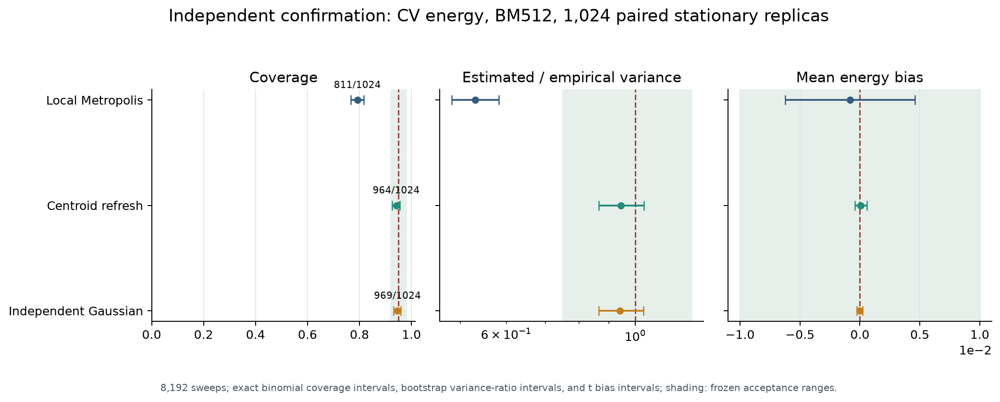
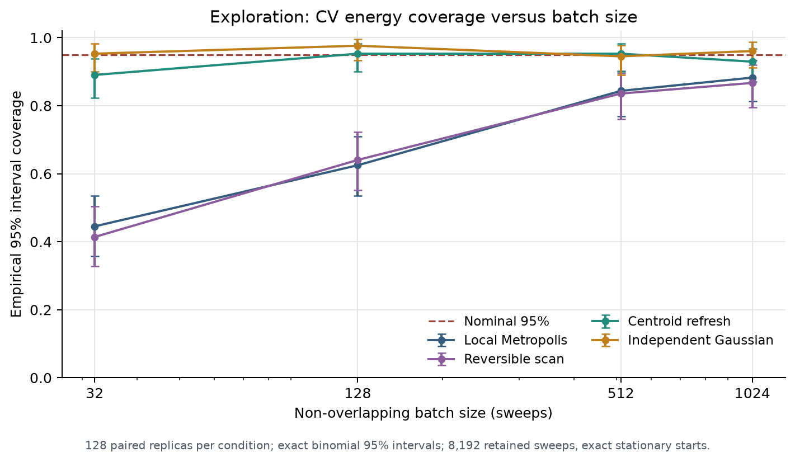
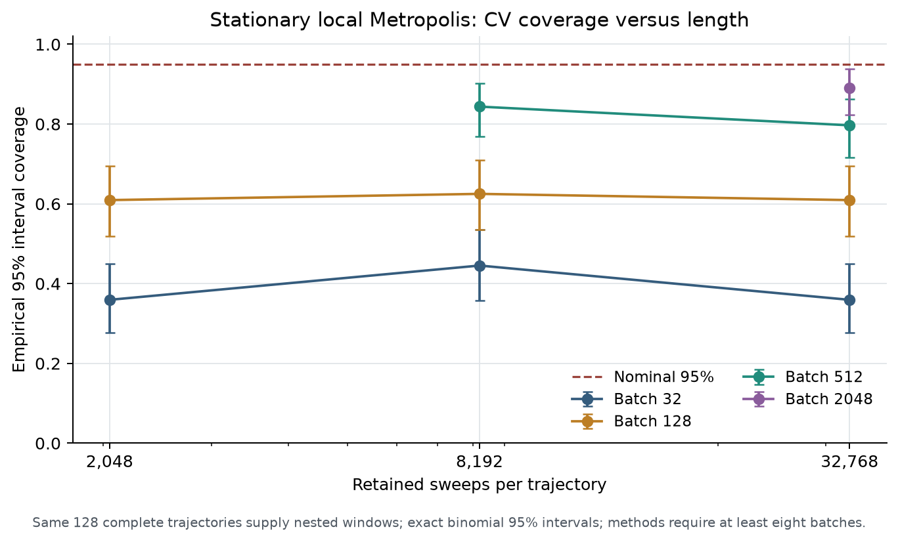
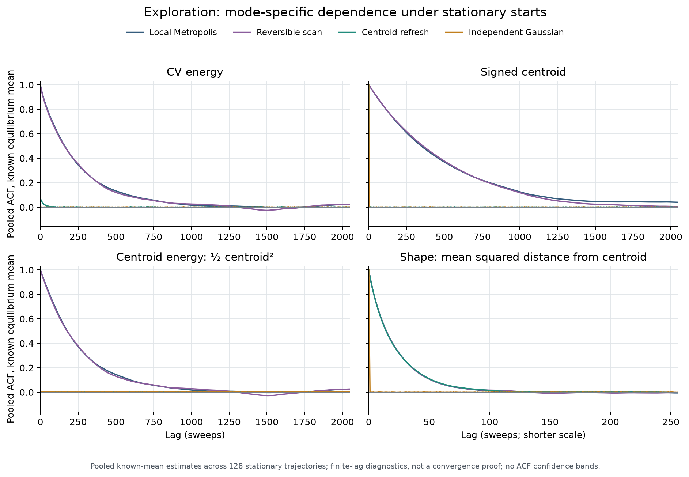

> Publication note: this is the completed local experiment report. Statements about files not yet pushed or an isolated patch describe that run before publication. The repository now includes the optional patch. Full raw traces are not distributed; see [data availability](../DATA_AVAILABILITY.md).

# RNGLab Phase II: PIMC root-cause investigation

30 October 2026 · audited repository revision `dd96adba23b8100aba9147d71fffc63932fc6b0d`

## Finding

The severe healthy-source undercoverage is explained by equilibrium dependence that the short-batch uncertainty estimates fail to capture, with slow collective centroid dynamics accounting for most of the observed variability of CV energy averages. Initialization can add transient bias, but it is not required for the failure. We found no finite-M reference, TD/CV formula, Student-t quantile, or saved coverage-count error.

This assessment rests on independent reference calculations, exact independent Gaussian paths, exact equilibrium starts, a targeted centroid intervention, a new frozen confirmation experiment, and a synthetic dependence control with analytically known finite-run variance. It is stronger than an inference from an ACF plot alone. It does not establish that every remaining interval defect is caused by the centroid, that the Metropolis centroid is exactly AR(1), or that a particular variance estimator is valid for arbitrary PIMC workloads.

The original result is a healthy-PRNG sampler/uncertainty failure. The separate controlled adapter-fault experiment is documented in [Controlled_RNG_fault_report.md](Controlled_RNG_fault_report.md).

## 1. Preserved evidence and recovered experiment

The independent checker read all **786,432 original trace rows**, recomputed 768 individual intervals and all 12 saved coverage counts, and checked all 64 seeds and trajectories for duplication. It did not import or execute the original simulator. Ten Phase I artifacts, including the script, traces, summaries, report, methodology, bibliography and detector inventories, have recorded original hashes. Originals were preserved.

The model is a one-dimensional unit harmonic oscillator, with mass, angular frequency and ℏ equal to one. Its primitive periodic-bead action is

\[
S_M(x)=\frac{M}{2\beta}\sum_j(x_{j+1}-x_j)^2+
\frac{\beta}{2M}\sum_jx_j^2,\quad M=16,\;\beta=2.
\]

Every sweep visits all 16 beads in fixed order. A proposal is `x[j]+0.4*(2*u-1)`, followed by a fresh acceptance input and the usual Metropolis rule. An acceptance variate is consumed even for downhill proposals. Each of 64 Python `random.Random` replicas starts with uniform bead coordinates in [−0.5,0.5). Its seed is the first 128 SHA-256 bits of `rnglab-pimc-pilot-20261030-scalar-v1/{replica:03d}`. The full records contain 12,288 sweeps per replica.

The short window is sweeps 1,025–4,096, n=3,072; the long window is 4,097–12,288, n=8,192. These share trajectories and change both warmup and retained length. They are not independent experiments.

For b=32,128,512, the pilot uses nonoverlapping batch means, estimated variance `sample_var(batch_means)/number_of_batches`, and a two-sided Student-t critical value with `number_of_batches−1` degrees of freedom. All lengths divide exactly. The long CV results are:

| Batch | Coverage | Wilson 95% interval | Mean estimated / empirical variance of chain means |
|---:|---:|---:|---:|
| 32 | 20/64 = 31.25% | 21.2–43.4% | 0.0493 |
| 128 | 38/64 = 59.38% | 47.1–70.5% | 0.1694 |
| 512 | 48/64 = 75.00% | 63.2–84.0% | 0.4288 |

The empirical variance of those 64 long CV means is 0.008754462. Average estimated MC variances are 0.000431840, 0.001482912 and 0.003754337. The coverage arithmetic is correct, but the reported error bars are small relative to independent-chain variability.

Two provenance corrections are needed: the pilot JSON's “one bead per sweep” wording should say every bead once; its four-batch minimum differs from the main repository's eight-batch rule. In particular, short-window b=512 has only six batches. Neither issue changes the long-window counts. See the [complete baseline verification](../baseline/baseline_verification_report.md).

## 2. Independent finite-M reference and formulas

With periodic difference matrix D and L=DᵀD,

\[
Q=\frac\beta M I+\frac M\beta L,\quad
q_k=\frac\beta M+\frac{4M}\beta\sin^2(\pi k/M),\quad
x\sim N(0,Q^{-1}).
\]

The energy formulas checked are

\[
E_{TD}=\frac M{2\beta}-\frac M{2\beta^2}\sum_j(x_{j+1}-x_j)^2+
\frac1{2M}\sum_jx_j^2,
\quad
E_{CV}=\frac1{2\beta}+\overline{x^2}-\frac12\bar x^2.
\]

Eigenmode sums, dense Gaussian quadratic-form moments and a numerical derivative of log Z agree with

\[
E_M=\frac{\coth[M\operatorname{asinh}(\beta/(2M))]}{2\sqrt{1+(\beta/(2M))^2}}
=0.655474152298173\ldots.
\]

The continuum energy is 0.656517642749666, a discretization difference of 0.00104349045. All coverage calculations in this investigation use **E_M**. The repository separately labels an energy bias against the continuum; that quantity must not be substituted for finite-M MC bias.

Deterministic checks passed on 18 (M,β) settings. Student-t critical values were independently integrated from their density and match the pilot's incomplete-beta implementation within 10⁻⁹. The accelerated kernel was checked against a separate scalar implementation and full-action differences; a 200,000-path Gaussian moment check passed analytic six-standard-error bounds. These checks and exact-path sampling found no demonstrated estimator or interval-arithmetic defect. The centroid virial construction is established PIMC methodology, not a new estimator ([Yamamoto, 2005](https://arxiv.org/abs/physics/0505109)).

## 3. Design and separation of experiments

The new standalone float64 implementation uses NumPy PCG64 with SHA-256-derived full 256-bit seeds, separate roles for initialization, local updates, centroid draws, scan order and IID paths. A trajectory is the replication unit. Conditions intentionally share role/replica seeds within a stage for pairing; exploratory, confirmation, fault calibration and fault test stages are disjoint. Unique seeds and nonduplicated data are bookkeeping evidence, not a proof of independence of pseudorandom streams.

Exploration used 128 replicas per configuration. It varied n=2,048/8,192/32,768; initial states exact equilibrium/uniform/zero/all +3; burn-in 0/1,024/4,096 while retaining the same 8,192 observations; proposal half-width 0.15/0.4/1.0; and fixed-order, 50/50 forward/reverse, centroid-refresh and IID updates. All raw TD/centroid/shape records, acceptance rates, seeds and endpoints are retained.

Before generating confirmation data, the local protocol and code hash were frozen. The **new 1,024-replica confirmation** uses M=16, β=2, δ=0.4, n=8,192 and exact stationary Gaussian starts. Its single primary endpoint is CV coverage using BM512 and t₁₅. Required healthy controls were centroid refresh and IID paths. Each had to meet all three criteria:

- Exact binomial 95% coverage interval wholly inside 92–98%.
- Replica-bootstrap 95% interval for estimated/empirical variance wholly inside 0.75–1.25.
- Across-replica mean-bias 95% interval wholly inside −0.01 to +0.01.

The paired centroid-refresh coverage improvement also had a prespecified lower 95% bound exceeding 10 percentage points. This is a locally frozen validation protocol, not an externally registered study. No batch or threshold was retuned using confirmation results. At 95% coverage, 1,024 independent units give approximate 95% precision of ±1.34 percentage points: enough to distinguish the observed severe failure and screen practical calibration, not certify exact 95% coverage.

## 4. Confirmation results

| Update | Covered / 1,024 | Coverage, exact 95% interval | Estimated / empirical MC variance, bootstrap 95% interval | Mean bias, 95% interval |
|---|---:|---|---|---|
| Local Metropolis | 811 | 79.20%, 76.58–81.65% | 0.531, 0.484–0.582 | −0.000807, −0.006224 to +0.004610 |
| Local + centroid refresh | 964 | 94.14%, 92.52–95.50% | 0.944, 0.865–1.036 | +0.0000667, −0.000435 to +0.000568 |
| Independent Gaussian paths | 969 | 94.63%, 93.07–95.93% | 0.941, 0.865–1.033 | −0.0000155, −0.000272 to +0.000241 |

Both required healthy controls pass all frozen criteria. Local Metropolis fails coverage and variance criteria. Centroid refresh improves paired coverage by **14.94 percentage points**, bootstrap 95% interval **12.11–17.87**; 202 pairs improve and 49 worsen. The correction is validated for this harmonic setting, update schedule, initialization and interval, not for all choices in the parameter space.

The empirical variance of CV chain means falls from 0.00780456 to 0.0000668355, about a 117-fold reduction, while the equilibrium target stays fixed. The IID value is 0.0000174752. This compares variance of the run mean at a fixed 8,192 recorded sweeps; a wall-clock efficiency comparison including collective-update costs was not performed.

## 5. Why the centroid matters

Write x=c1+y, Σy=0. The action factorizes as S=βc²/2+S(y), with c∼N(0,1/β), independent of y at an equilibrium time. Then

\[
E_{CV}=1/(2\beta)+c^2/2+r_g^2,\qquad r_g^2=M^{-1}\sum_jy_j^2.
\]

The centroid term contributes 0.125 of the exact marginal CV variance 0.134631445, or 92.85%. This is a same-time fraction. We also measured the relevant **between-replica variance of time averages**, including its covariance term:

| Confirmation update | Var(mean c²/2) | Var(mean r_g²) | 2 Cov | Total Var(mean CV) |
|---|---:|---:|---:|---:|
| Local | 0.00776972 | 0.0000503958 | −0.0000155496 | 0.00780456 |
| Centroid refresh | 0.0000148572 | 0.0000520579 | −0.0000000797 | 0.0000668355 |
| IID | 0.0000162665 | 0.00000117266 | +0.0000000360 | 0.0000174752 |

The intervention replaces c with an independent N(0,1/β) after every full sweep and shifts all beads equally; it leaves springs and internal coordinates unchanged at that update. Factorization proves target invariance. Refreshing the centroid removes its long dependence and changes its mean-variance contribution sharply while the shape contribution remains similar. This links the dominant error component to a targeted, mathematically valid intervention. Collective harmonic sampling and special centroid treatment have close prior work; this is a diagnosis and implementation validation, not a new sampling principle ([Moustafa and Schultz, 2024](https://arxiv.org/abs/2404.12551)).

The shape is still temporally correlated. For centroid refresh, treating all 8,192 CV values as IID covers only 685/1,024 = 66.89%. Thus the update does not license IID error bars. BM512 was the validated primary choice.

## 6. Exploratory dependence and variance-method results

All following comparisons are descriptive exploration or secondary endpoints. Full bias intervals, coverage intervals, empirical/estimated variances, bootstrap ratios, ESS, abstentions and acceptance rates are in the machine-readable tables.

- **Length alone with fixed short batches:** stationary local BM512 covers 108/128 at n=8,192 and 102/128 at n=32,768. At n=32,768, increasing b to 2,048 gives 114/128. Four times as many observations does not eliminate a fixed-lag variance-estimation bias.
- **Warmup:** displaced +3 starts with zero burn-in have mean bias +0.13525 (95% interval +0.11637 to +0.15414). With 4,096 burn-in it is +0.00305 (−0.01185 to +0.01796), while BM512 coverage remains 102/128. Uniform and zero starts show no monotone general cure from more burn-in. A transient can inflate an interval as well as shift its center; apparently high coverage need not mean unbiased equilibrium inference.
- **Proposal size:** δ=0.15/0.4/1.0 gives local acceptance about 88.07%/69.57%/38.88% and BM512 coverage 68/108/113 of 128 at n=8,192. High acceptance is not evidence of rapid centroid mixing. These settings were not optimized or independently confirmed as an acceptance rule.
- **Reversible sweep mixture:** 50/50 complete forward/reverse sweeps yield 107/128 BM512 coverage. Reversibility alone does not solve slow mixing.
- **Independent paths:** retain the identical observable and interval machinery while removing temporal dependence, and pass the independent confirmation. A shared reference/formula/quantile error is therefore an inadequate account of the local-chain failure.

Confirmation secondary CV results illustrate that returning a number is not validation:

| Variance / interval method | Local coverage | Centroid-refresh coverage | IID coverage |
|---|---:|---:|---:|
| Naive IID t | 71/1,024 | 685/1,024 | 961/1,024 |
| BM32 t | 365/1,024 | 886/1,024 | 965/1,024 |
| BM128 t | 634/1,024 | 951/1,024 | 969/1,024 |
| BM512 t, primary | 811/1,024 | 964/1,024 | 969/1,024 |
| BM1024 t | 858/1,024 | 964/1,024 | 963/1,024 |
| Geyer IMS normal, sensitivity | 825/1,024 | 931/1,024 | 961/1,024 |
| Overlapping BM512 normal | 790/1,024 | 937/1,024 | 958/1,024 |
| Bartlett512 normal | 781/1,024 | 937/1,024 | 947/1,024 |

No variance estimator abstained in these recorded primary/secondary confirmation rows. BM2048 is omitted because n=8,192 supplies only four batches, below the new eight-batch minimum. OBM and Bartlett use asymptotic normal intervals, so their coverage differences include interval critical-value differences as well as variance estimation.

Median estimated BM512 ESS is 36.8 for local, 2,282.7 for refreshed, and 8,544.0 for IID. These estimates inherit their MC variance estimator's errors. They are not proofs of convergence or true effective sample counts. Pooled known-mean ACFs avoid concealing long tails by subtracting a different mean from every short chain; the finite lag range still cannot prove a complete integrated autocorrelation time.

Systematic full sweeps preserve the target but are generally **nonreversible**, although individual bead updates are reversible. Geyer's usual positive/monotone sequence justification consequently does not automatically apply; it is explicitly a sensitivity analysis here. Batch and spectral consistency also need dependence/moment conditions and appropriate batch/bandwidth growth. See [Geyer, 1992](https://doi.org/10.1214/ss/1177011137), [Flegal and Jones, 2010](https://arxiv.org/abs/0811.1729), and the [method review](../theory/PIMC_mathematical_reference_and_method_review.md).

## 7. Analytic dependence control

A separate **synthetic target-preserving update**, not the Metropolis kernel or an RNG fault, draws internal Gaussian modes independently each step and evolves a stationary centroid as

\[
c_t=\phi c_{t-1}+\sqrt{(1-\phi^2)/\beta}\,Z_t.
\]

The CV marginal distribution remains exactly the same. Its autocovariances are known: γ₀=0.134631445 and γₖ=0.125φ²ᵏ for k>0. Exact finite-n mean variance follows by summing γₖ with weights (1−k/n)/n. The expected BM variance is exactly `(Var(block_mean_b)−Var(full_mean_n))/(number_of_blocks−1)`.

For 1,024 independently seeded n=8,192 trajectories per φ:

| φ | BM32 / BM128 / BM512 coverage counts | Exact expected BM512 / true MC variance | Oracle normal interval coverage count |
|---:|---|---:|---:|
| 0 | 976 / 979 / 980 | 1.0000 | 975 |
| 0.997 | 438 / 698 / 861 | 0.6846 | 985 |
| 0.999 | 249 / 479 / 723 | 0.3586 | 971 |

All denominators are 1,024. All nine average BM variance estimates agree with their exact expectations within 1.83 empirical standard errors. Oracle intervals use the exact finite-n variance and 1.96, not an estimated MCSE; their observed coverage intervals all include 95%. This reproduces severe interval failure using known dependence alone, a correct target and healthy random draws.

The mean remains skewed in the strongly dependent controls. Post hoc fixed-width diagnostics also show that replacing random BM variance estimates by their expectation does not reproduce the same coverage: variability of MCSEs and their association with mean errors matter. These diagnostics are labeled secondary. Exact variance plus a normal critical value is not a general finite-sample theorem. See the [executed analytic control report](../analytic-dependence/analytic_dependence_report.md) for exact formulas, seed records, asymmetry and uncertainty.

## 8. Competing explanations: evidence and remaining limits

| Hypothesis | Evidence | Assessment in this workload |
|---|---|---|
| Wrong finite-M reference | Eigenmodes, dense Gaussian moments, log-Z derivative; IID coverage | No demonstrated defect; continuum target is separately identified |
| Wrong TD/CV formula | Independent derivations, upstream comparisons, Gaussian moments | No demonstrated defect for this action |
| Wrong interval arithmetic | Independent t-density integration and individual-interval recount | No arithmetic explanation found; dependence assumptions fail |
| Insufficient warmup | Nonstationary-start study and exact equilibrium starts | Real additional transient for displaced starts; not a necessary cause |
| Slow mixing / long dependence | Stationary failure, ACFs, centroid variance decomposition, exact centroid intervention | Strongly supported; dominant centroid contribution identified |
| Too few observations | Length variation at fixed and growing batch sizes | Finite effort matters; merely extending n with short fixed b does not cure the error |
| Unreliable variance estimation | Ratios far below one, secondary methods, exact dependence-control expectations | Directly measured; batch correlation and noisy MCSEs explain substantial failure |
| Nonstationarity | Exact-target starts and invariant kernels still fail | Not required; no universal convergence guarantee inferred |
| Dependent/duplicated replicas | Full manifests, distinct seeds, no duplicate original traces, disjoint stages | No bookkeeping duplication found; PRNG stream independence remains an assumption |
| Experimental implementation error | Independent checker, scalar/compiled comparison, full-action checks, tests | No known blocker after validation; not an exhaustive proof of all software |

The main residual uncertainty is the precise finite-n distribution and complete long-run covariance of the systematic Metropolis estimator, including MCSE/error coupling. This study does not derive that kernel's spectral gap or prove its CLT. The targeted intervention and independent confirmation nevertheless identify a practical correction and distinguish the major competing causes of the observed failure.

## 9. Implemented correction and validation

An optional explicit-source `harmonic_centroid_heatbath` helper and simulation argument were implemented in an isolated repository copy. It uses 16 audited source bytes per draw with an explicit Box-Muller transform, records source provenance/consumption, validates the domain and preserves the default local sampler behavior. It is specific to the harmonic action and assumes appropriate healthy independent random inputs.

The unchanged repository passed **238 tests**. The final optional patch passed **257 tests**, including 19 new cases. The standalone study passed 9 tests; fault adapter/window checks passed 14; independent baseline checks passed 3; RUS checks passed 5; analytic dependence checks passed 4. Exact logs and subsequent artifact validation are in the deliverable directories. No unexecuted remote test is reported as passing.

The numerical confirmation was run with the independently validated standalone NumPy/Numba kernel, not as a coverage campaign through the patched repository API. The upstream patch has mathematical and regression validation; an independently frozen coverage check through that API is the next integration milestone. The original source snapshot and GitHub main were not changed. The reviewable [patch](../environment/pimc-centroid-heatbath.patch), [patch note](../environment/centroid_update_patch.md), exact [environment lock](../environment/requirements-lock.txt) and [reproduction guide](../REPRODUCE.md) are included.

GitHub's failed CI jobs never started: both check annotations identify an account billing lock. Local tests pass, so that CI status is not evidence of a code test failure. The [environment report](../environment/environment_report.md) retains the public API evidence and the local interpreter limitation: Python 3.14.7 was tested; the remote 3.11/3.12 matrix was not newly run.
