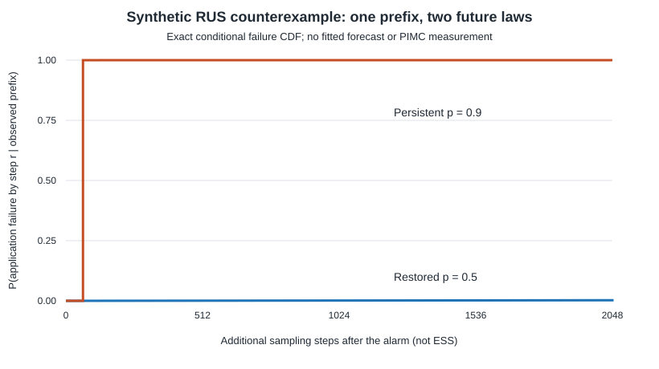

> Publication note: this is the completed local experiment report. Statements about files not yet pushed or an isolated patch describe that run before publication. The repository now includes the optional patch. Full raw traces are not distributed; see [data availability](../DATA_AVAILABILITY.md).

# Alarm-conditioned RUS: executed identifiability counterexample and proposed protocol

Date: 30 October 2026. This is a **synthetic Bernoulli Monte Carlo workload**, constructed to isolate a mathematical limitation. It is not a PIMC result, a physical-source experiment, or successful forecasting.

## Executed counterexample

The intended Monte Carlo quantity is E[B]=0.5 for B~Bernoulli(0.5). A source initially generates p=0.5 observations and changes to p=0.9 at sample t₀=513. The source alarm is the first rolling 64-sample count of at least 48 ones. The saved observed prefix alarms at **tₐ=556**. That entire prefix, every source statistic available at issuance, and the alarm time are identical in the two possible worlds.

Immediately after the alarm, the unobserved future source law is either:

- **Restored:** future observations have p=0.5 independently.
- **Persistent:** future observations have p=0.9 independently.

The regime represents an unknown future development, not a repair decision revealed to the forecaster. Both data-generating worlds have the same probability law through the alarm. Merely observing the prefix therefore cannot identify the regime.

The application estimates 0.5 from each disjoint block of 64 additional observations. A block fails if its mean has absolute error at least 0.25, equivalently a count ≤16 or ≥48. Let K be the first failing post-alarm block, T=tₐ+64K, and

\[
R=\max(0,T-t_a)=64K.
\]

R is measured in additional sampling steps, not ESS. The forecast would be issued once at the first alarm. Administrative censoring occurs at 2,048 additional samples (32 blocks); the recorded outcome is (min(R,2048),1{R≤2048}). No model was trained and no narrow forecast was issued.

For a specified future p, each block fails with the exactly calculable probability

\[
q(p)=\sum_{k\le 16\;\mathrm{or}\;k\ge 48}{64\choose k}p^k(1-p)^{64-k},
\]

so K is geometric and P(R≤64j)=1−(1−q)^j. This is an exact benchmark requiring neither MCMC nor an asymptotic confidence interval.

The script generated 1,024 independently seeded future continuations conditional on the same saved prefix. The two regimes use paired future uniforms within each replicate. These are 1,024 conditional experimental units, not 2,048 independent observed histories.

| Future regime | Exact per-block failure probability | Exact failure by 2,048 steps | Observed events | Empirical failure probability, Wilson 95% interval | Exact median R |
|---|---:|---:|---:|---:|---:|
| p=0.5 restored | 0.0000773308 | 0.2472% | 4/1,024 | 0.3906%, 0.1520–1.0001% | 573,696 steps |
| p=0.9 persistent | 0.9998641150 | approximately 100% | 1,024/1,024 | 100%, 99.6263–100% | 64 steps |

The observed event-only median of 992 steps in the restored branch is **not** a median R estimate: 1,020/1,024 continuations were censored. The exact model supplies the 573,696-step median; the 2,048-step experiment cannot estimate it nonparametrically. This deliberately distinguishes censoring from observed failure times.

## Identifiability consequence

Let Hₐ denote all observations through the alarm. The two worlds induce identical laws for Hₐ but different laws for R conditional on Hₐ. Any forecasting rule based only on Hₐ must give the same answer in both worlds. A unique, informative regime-specific distribution of R is consequently unavailable without assumptions identifying how degradation evolves after the alarm.

If an unknown mixture weight w specifies the probability of persistence, then

\[
P(R\le r\mid H_a)=(1-w)F_{0.5}(r)+wF_{0.9}(r).
\]

Here the prefix likelihood does not identify w because the prefix law is identical across regimes. Model assumptions, a known intervention, new post-alarm observations, or external information could identify or constrain it. A forecast can be conditional on an explicitly assumed regime or can report a sensitivity band across regimes. Without that information the appropriate action is abstention from a narrow forecast. This is not a theorem that all RUS forecasting is impossible.

The source alarm was chosen for this construction. Its whole-run false-alarm rate was not calibrated or compared with another monitor. The application failure criterion is a defined block-estimation error, not the healthy PIMC uncertainty failure. No superiority of an application-aware monitor is claimed.

## Narrow proposed RUS protocol after computational controls pass

This protocol is proposed and unexecuted. The counterexample above is the completed experiment. Its purpose is to make the missing assumptions explicit before investing in prediction.

Use this analytically validated Bernoulli workload first. Freeze one post-alarm evolution family, such as a latent p that follows a bounded random walk with a specified drift and diffusion, or a specified constant-p persistence model. Register the family and its parameter distribution; a repaired regime is either included as a labeled alternative or excluded by an explicit deployment assumption. Do not mix unknown arbitrary futures under a single calibration claim.

Define t₀, first source alarm tₐ, the 64-sample block application failure T, R=max(0,T−tₐ), a 2,048-step horizon and right censoring before simulation. Calibrate a first-alarm rule to a 5% whole-trajectory false-alarm budget on healthy trajectories. Freeze the threshold after calibration. Issue exactly one forecast per trajectory at the first alarm; do not treat rolling forecasts or blocks as independent replicates. Trajectories with no alarm have no issued RUS forecast and must be counted separately.

Use distinct SHA-derived seed namespaces for exploratory design, calibration and final evaluation. Fix the final seed list and analysis code before opening evaluation data. Split by full trajectory and family parameter, ensuring that no prefix, continuation or paired stream crosses a split. Compare any fitted forecast with the exact conditional survival curve available under the registered family and with a training-only survival baseline. Report horizon-event Brier score, time-dependent calibration, forecast interval coverage and width, censoring, abstention and the fraction of alarms occurring after application failure. Fix evaluation times before the holdout; retain all prefixes and continuations.

An appropriate first evaluation has at least 512 independent alarmed holdout trajectories with adequate failures and censoring under the prespecified model. At true 95% coverage, 512 units give a binomial standard error of about 0.96 percentage points; this is useful for screening material miscalibration but not a narrow guarantee. The stopping rule is a fixed trajectory budget, not “run until a favorable score.” A separate repaired-future holdout then measures sensitivity to the assumption identified by this counterexample.

Advance to a PIMC RUS study only after its healthy observable, failure definition and uncertainty method have independent validation. Forecasting a confidence-interval failure whose healthy mechanism remains unresolved would make interpretation ambiguous. HPC and physical equipment are unnecessary for this Bernoulli milestone.

## Reproduction and files

Run `python rus_identifiability.py`. The script uses only Python's standard library and finishes in under a second in the recorded environment. It writes the exact observed prefix, 1,024 future seed records, 2,048 paired outcome records, a numerical JSON summary and the exact-CDF SVG. No original Phase-I evidence is overwritten.

The calculations are elementary finite-binomial and geometric-distribution identities; the numerical simulation is a reproducibility check. It does not add an empirical success claim about the RNGLab forecast models.
