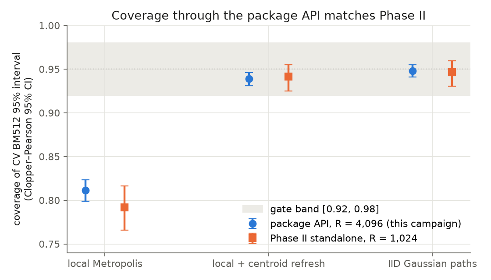
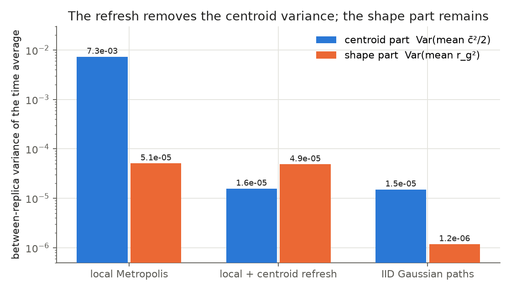
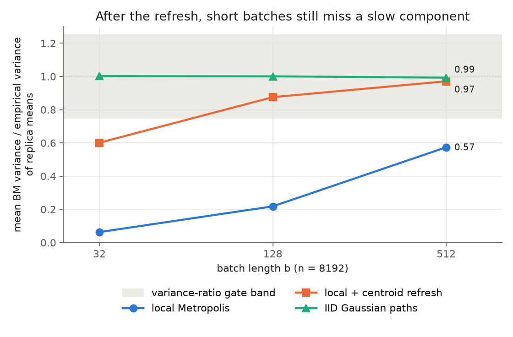

# v0.18 Phase 2 report: the Phase II core result through the package API

**Protocol and code.**
- Protocol `rnglab-v018-api-validation-v1`, frozen at commit `0cbefb4` (`protocol.json` SHA-256 `8a75df73…eb22d`).
- Campaign scripts at `f9fa0f2`. The pre-generation manifest, at `ff948e2`, was pushed to GitHub before the first draw.
- Code under test: the PIMC run options ported from Codex (`c47e44f`) with the start-path digest and provenance (`4cf55a8`). The defaults are pinned bit-for-bit by the golden test (`caaf784`).

**Run.** Generation ran 2026-11-06 from 09:07:17 to 09:55:49 UTC: 48 of 48 blocks, 3 × 4,096 replicas. Analysis, recount, figures and this report were produced by Claude Code (Opus 5.5); the design decisions are the author's.

**Sources of numbers.** Every number below is copied from `results/report_tables.md` (generated by `report_tables.py`) or directly from `results/gates.json`, `results/secondary.json`, `results/recount.json`, `results/run.log` and `results/posthoc_bias_check.json`. The last of these is a post-hoc check and is labelled as such where used.

## Answer in brief

| Hypothesis | Frozen verdict | What it means |
|---|---|---|
| H-API: refresh and IID control pass the Phase II healthy gates through the package API | **SUPPORTED** | G-R and G-I pass on all three criteria |
| H-REP: local Metropolis under-covers, and the refresh improves paired coverage by > 0.10 | **SUPPORTED** | F-L and P-RL pass |
| Phase II core result reproduced through the API | **YES** | All four implementation checks pass; the independent recount agrees 21/21 |

**Two secondary findings, without gates, carry equal weight:**
- **The batch-length diagnostic fails on the refreshed sampler.** It accepts every refreshed run, but its intervals cover only 0.883.
- **There is a small, unexplained bias in the refresh condition.** Its interval excludes zero, though it lies far inside the ±0.01 gate tolerance.

The package's default batch sizes (32 and 128) also under-cover with the refresh. Section 4 covers all three.

## 1. Primary endpoint: CV with BM512 (16 batches, t₁₅)

| Condition | Covered / R | Coverage CP95 | Variance ratio (bootstrap CI95) | Mean bias (CI95) | Not estimated |
|---|---|---|---|---|---:|
| Local Metropolis | 3323/4096 (0.8113) | [0.7990, 0.8232] | 0.574 [0.546, 0.603] | −0.000582 [−0.003210, 0.002047] | 0 |
| Local + centroid refresh | 3846/4096 (0.9390) | [0.9312, 0.9461] | 0.971 [0.929, 1.015] | −0.000321 [−0.000567, −0.000075] | 0 |
| IID Gaussian paths | 3884/4096 (0.9482) | [0.9410, 0.9548] | 0.993 [0.950, 1.039] | −0.000006 [−0.000130, 0.000118] | 0 |

| Gate | Criterion | Value | Result |
|---|---|---|---|
| G-R coverage | CP95 inside [0.92, 0.98] | [0.9312, 0.9461] | PASS |
| G-R variance ratio | CI95 inside [0.75, 1.25] | [0.929, 1.015] | PASS |
| G-R bias | CI95 inside [−0.01, 0.01] | [−0.000567, −0.000075] | PASS |
| G-I coverage | CP95 inside [0.92, 0.98] | [0.9410, 0.9548] | PASS |
| G-I variance ratio | CI95 inside [0.75, 1.25] | [0.950, 1.039] | PASS |
| G-I bias | CI95 inside [−0.01, 0.01] | [−0.000130, 0.000118] | PASS |
| F-L | local CP95 upper < 0.92 | 0.8232 | PASS |
| P-RL | paired lower bound > 0.10 | 0.1277 [0.1138, 0.1414]; refresh only 713, local only 190 | PASS |

The refreshed sampler's coverage interval [0.9312, 0.9461] sits below 0.95 but inside the gate band. The design calculation had anticipated this region: Phase II's point estimate was 0.941.

## 2. The Phase II mechanism, reproduced

**Agreement with Phase II.** All three conditions agree with Phase II within the Wald 95% interval of the difference. This holds despite a different implementation, different random sources, a different way of consuming acceptance words, and a different centroid transform.

| Condition | API coverage | Phase II coverage | Difference (Wald CI95) |
|---|---:|---:|---|
| Local Metropolis | 0.8113 | 0.7920 | 0.0193 [−0.0083, 0.0469] |
| Local + centroid refresh | 0.9390 | 0.9414 | −0.0024 [−0.0186, 0.0137] |
| IID Gaussian paths | 0.9482 | 0.9463 | 0.0020 [−0.0134, 0.0173] |

**Where the variance comes from.** The between-replica variance of the CV time average splits into a centroid part, a shape part and twice their covariance:
- Under local Metropolis the centroid part dominates: 7.309e-03 of 7.362e-03.
- The refresh brings the centroid part to 1.567e-05, which is the IID level of 1.508e-05.
- After the refresh the shape part (4.865e-05) is the largest term, against 1.179e-06 for the IID control.

The refresh therefore removes the dominant slow mode, the centroid, but local moves still mix the path's shape slowly. Section 4.1 shows why that matters.

## 3. Implementation checks and recount

| Check | Value | Result |
|---|---|---|
| I-1 byte ledger | 0 mismatches | PASS |
| I-2 start pairing | 0 mismatched replicas | PASS |
| I-3 trace consistency | max abs difference 8.88e-16 (tolerance 1e-12) | PASS |
| I-4 deterministic replay | 3/3 identical | PASS |
| Independent recount | 21/21 agree | PASS |

**What the checks cover.**
- **I-1, byte ledger:** every replica used exactly the planned number of bytes for each role, and no role shared a source.
- **I-2, start pairing:** the local and refresh runs of each replica started from the same exact path, and that path regenerates from its seed.
- **Recount:** `recount.py` shares no code with the analysis or the package. Working from the raw CV traces, it reproduces every coverage count, every per-replica flag, the Clopper–Pearson, bias and variance-ratio intervals, and the paired comparison.

## 4. Secondary findings (descriptive, no gates)

### 4.1 The batch-length diagnostic fails on the refreshed sampler (negative)

| Condition | ADEQUATE / RUN_TOO_SHORT / TAU_UNDEFINED | Adaptive coverage | Geyer τ̂ median [q05, q95] |
|---|---|---|---|
| Local Metropolis | 0 / 4096 / 0 | — | 294.7 [137.7, 640.2] |
| Local + centroid refresh | 4096 / 0 / 0 | 3616/4096 (0.8828) | 3.1 [2.1, 4.8] |
| IID Gaussian paths | 4096 / 0 / 0 | 3887/4096 (0.9490) | 1.0 [1.0, 1.1] |

**What was expected.** The prediction recorded before generation held for local Metropolis: the diagnostic refused every run as too short.

**What went wrong.** On the refreshed sampler the diagnostic judged every run adequate, but the intervals it chose covered only 0.8828 (CP95 [0.8726, 0.8925], `secondary.json`). The cause is visible in the variance ratios:
- Geyer's τ̂ has median 3.1, so the rule "batch ≥ 10·τ̂" picks batches far shorter than 512.
- Short batches underestimate the long-run variance: the BM variance ratio is 0.601 at b = 32, 0.875 at b = 128 and 0.971 at b = 512.
- Geyer's own estimate is also low, at 0.820.

This is consistent with a fast component plus the slow shape mode of Section 2. Geyer's initial-sequence truncation and short batches both miss the slow mode.

**What it means.** Phase 1's H-D result ("never accepts and then mis-covers", on AR(1)) does not carry over to this sampler. The Phase 1 protocol (§8) had warned that the 10·τ̂ constant came from AR(1) and might fail for processes with several time scales; this is that failure, observed. A systematic sweep is also not reversible, which Geyer's theorem assumes (Phase II theory document §4).

### 4.2 The package's default batch sizes under-cover

`run_simulation` reports batch means with b = 32 and 128 by default; the v0.18 golden test deliberately keeps those defaults unchanged.

**Coverage at the defaults:**
- With the refresh: 0.8611 at b = 32 and 0.9260 at b = 128.
- Without the refresh: 0.3672 and 0.6211.

A caller who relies on the default intervals for this sampler will get under-covering intervals. The calibrated interval comes only from the protocol's b = 512 (or longer).

**Other estimators, coverage and variance ratio (refresh condition):**

| Estimator | Coverage | Variance ratio |
|---|---:|---:|
| OBM512 | 0.9358 | 0.973 |
| SV-B512 | 0.9277 | 0.911 |
| SV-TH512 | 0.9290 | 0.937 |

TD with BM512 covers 0.9497 with the refresh and 0.8914 without.

### 4.3 A small bias in the refresh condition (open)

**The observation.** The refresh condition's CV bias interval excludes zero: −0.000321 [−0.000567, −0.000075]. E_M is 0.6554741522981734, and the bias is well inside the ±0.01 gate. Its TD bias interval also excludes zero, in the opposite direction: +0.001713 [0.000304, 0.003121] (`secondary.json`). With an exact stationary start and a kernel that preserves the target, both expected biases are exactly zero.

**Post-hoc check, not pre-registered** (`posthoc_bias_check.py` → `results/posthoc_bias_check.json`):
- The two deviations are t = −2.56 (CV) and t = +2.38 (TD).
- In the refresh condition the CV and TD replica means are negatively correlated, at −0.626.
- These are the only 2 of the 6 bias intervals reported (3 conditions × CV and TD) that exclude zero.

The negative correlation means one chance fluctuation would push CV and TD in opposite directions, so the two deviations are plausibly a single event rather than two. This campaign cannot separate chance from a small implementation effect in the refreshed kernel. **It is reported as unexplained.** A targeted follow-up would need its own protocol and namespace.

### 4.4 Other

- **Acceptance rates:** the median is 0.6958 in both Metropolis conditions; the package reports this at 4-decimal rounding.
- **IID control:** it behaves as theory predicts for IID data: BM variance ratio between 0.993 and 1.002 at every b, and Geyer τ̂ median 1.0. The spectral estimators run low (variance ratio 0.933 for both), as Phase 1 found at b/n = 1/16.

## 5. Deviations from the plan

- **Runtime.** Generation ran from 09:07:17 to 09:55:49 UTC (`run.log`), against a projected 36 minutes (`design.json`). The total block time was 11,611 s against a projection of about 8,600 single-core seconds, because replicas ran slower under parallel load than in the single-process smoke. No result is affected.
- **Post-hoc script.** One post-hoc script (`posthoc_bias_check.py`) was added after the frozen analysis. It is labelled as such and changes no verdict. No other deviation.

## 6. What Phase 2 does not show

- **One point only.** A calibration statement for one model at one parameter point (M = 16, β = 2, δ = 0.4), with exact starts, no burn-in and n = 8192. It does not transfer to other starts, run lengths, models or uncertainty methods.
- **Distributional, not bit-for-bit.** The API reproduces Phase II's coverage and mechanism, not its trajectories.
- **Healthy sources assumed.** The package PCG64 is a deterministic reference PRNG; no entropy or independence claim is made.
- **No RNG-fault evidence.** This campaign tests none of H1, H2 or H3. It establishes the healthy API baseline that Phase 3 (H1) needs.

## 7. Consequences for the next phases

- **Baseline.** Phase 3 can run through the package API, with BM512 on CV as the calibrated healthy baseline at this parameter point.
- **Interval method for fault monitoring.** The batch-length diagnostic, as specified, must not be used to choose intervals for the refreshed PIMC sampler. Deciding on a different constant, a minimum batch, or a diagnostic that sees multiple time scales is an open author decision (the "10·τ̂ constant" item in the open-decisions list). It needs its own protocol before it is used.
- **Package defaults.** The default batch sizes (32 and 128) stay unchanged by design. Their under-coverage should be documented for users of `run_simulation`.
- **The refresh bias** (Section 4.3) stays open until a targeted check is run.

## Files

- **Protocol and design:** `PROTOCOL.md`, `protocol.json`, `protocol.sha256`, `design_calculations.py` → `design.json`, `smoke/`, `manifest_pregeneration.json`
- **Scripts:** `run_campaign.py`, `analyze.py`, `recount.py`, `report_tables.py`, `plot.py`, `posthoc_bias_check.py`
- **Results** (committed):
  - `results/{local,refresh,iid}_replicas.csv` (one row per replica);
  - `results/gates.json`, `results/secondary.json`, `results/recount.json`, `results/posthoc_bias_check.json`;
  - `results/replay.json`, `results/run_manifest.json`, `results/run.log`, `results/report_tables.md`.
- **Traces** (`traces/`, about 3 GiB per `design.json`): not in Git. Every block's SHA-256 is in `results/run_manifest.json`.
- **Figures:** `figures/*.png`. Reproduction steps: [REPRODUCE.md](REPRODUCE.md).
