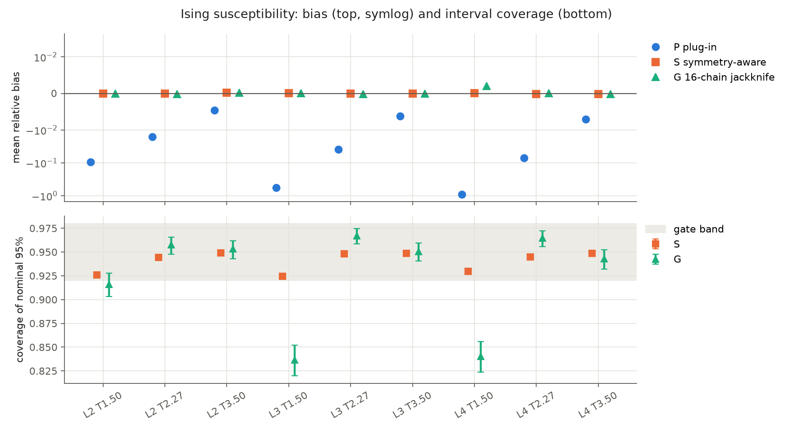
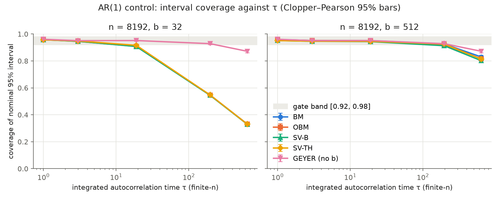
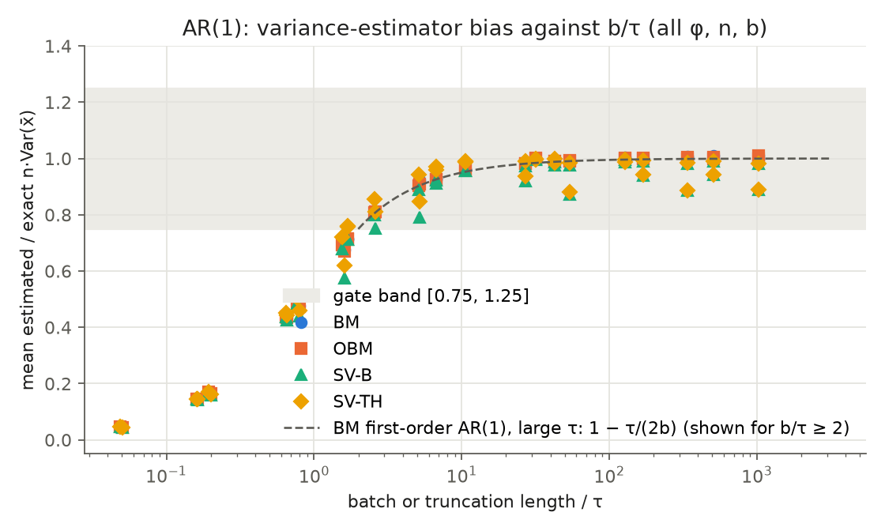
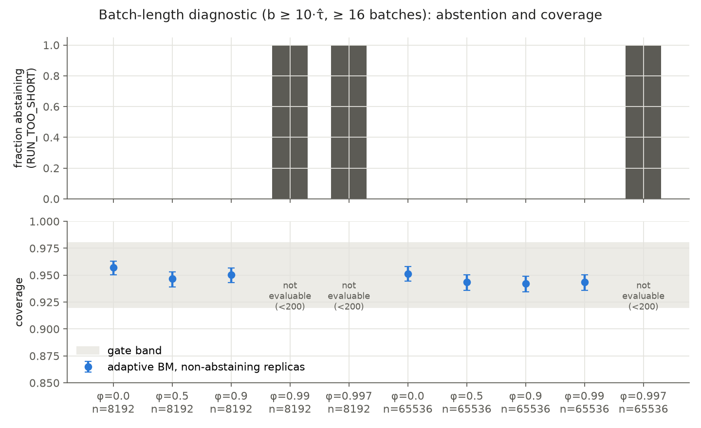

# v0.18 Phase 1 report: estimator repair

Protocol `rnglab-v018-estimators-v1`, frozen at commit `44676eb` (`protocol.json` SHA-256 `ab2f16a6…0ec66`). Pre-generation manifest at `f3be97a`. Generation finished 2026-11-05 10:39 UTC (19 of 19 settings). [Amendment 01](AMENDMENT_01.md), committed at `e9f1022`, was approved by the author before any campaign output was analysed. Analysis, recount, figures and this report were produced by Claude Code (Opus 5.5); the design decisions are the author's.

Every number below is copied from `results/report_tables.md` (generated by `report_tables.py` from `results/gates.json`, `results/ar1_table.csv`, `results/ising_table.csv` and `results/recount.json`) or from those files directly.

## Answer in brief

| Hypothesis | Frozen verdict | What it means |
|---|---|---|
| H-S: P fails at L4 T1.5; S and G calibrated in all nine cells | **NOT SUPPORTED** | P's failure reproduced. **S passes all 9 cells. G fails 5 of 9**: its point estimate is unbiased, but its interval is miscalibrated wherever chains do not change sign. |
| H-L: short-batch BM fails at long τ; BM, OBM, SV-B, SV-TH (b = 512) and Geyer calibrated for τ ≤ 19 | **SUPPORTED** | Both failures reproduced; all 15 calibration gates pass. |
| H-D: the diagnostic abstains or gives calibrated intervals; R̂ flags the Ising sign non-mixing | **SUPPORTED** | No adaptive gate fails; the diagnostic abstains wherever n < 160·τ̂. It is **conservative**: it also abstains where fixed intervals under-cover by only about 2–3 points. R̂ flags 2,048 of 2,048 ensembles at L4 T1.5. |
| Controls valid | **FALSE** (frozen rule) | One of 20 control intervals missed (AR(1), φ = 0, n = 8192). The Amendment 01 multiplicity-adjusted view flags no setting, so under the pre-specified reading this is a flag, not a defect, and no regeneration was triggered. |

An independent recount (own enumeration, own batch means, an explicit leave-one-chain-out loop, AR(1) regenerated by explicit recursion) agrees on **28 of 28** primary counts.

## 1. Susceptibility (Ising, nine exact-reference cells)

| Cell | χ exact | P rel. bias | S coverage | S rel. bias CI | S var. ratio CI | S-S | G coverage | G rel. bias CI | G var. ratio CI | S-G |
|---|---:|---:|---|---|---|---|---|---|---|---|
| L2_T1.5 | 2.6040 | -0.096 | 30339/32768 (0.926; [0.923, 0.929]) | [-0.00007, 0.00007] | [0.962, 0.993] | PASS | 1876/2048 (0.916; [0.903, 0.928]) | [-0.00046, 0.00030] | [1.627, 2.182] | FAIL |
| L2_Tc | 1.5411 | -0.016 | 30944/32768 (0.944; [0.942, 0.947]) | [-0.00027, 0.00004] | [0.961, 0.992] | PASS | 1961/2048 (0.958; [0.948, 0.966]) | [-0.00031, 0.00003] | [1.052, 1.192] | PASS |
| L2_T3.5 | 0.7769 | -0.005 | 31093/32768 (0.949; [0.946, 0.951]) | [-0.00010, 0.00037] | [0.980, 1.011] | PASS | 1952/2048 (0.953; [0.943, 0.962]) | [-0.00009, 0.00037] | [0.990, 1.125] | PASS |
| L3_T1.5 | 5.8559 | -0.567 | 30300/32768 (0.925; [0.922, 0.928]) | [-0.00003, 0.00009] | [0.972, 1.002] | PASS | 1713/2048 (0.836; [0.820, 0.852]) | [-0.00229, 0.00231] | [1.558, 2.023] | FAIL |
| L3_Tc | 3.2103 | -0.039 | 31072/32768 (0.948; [0.946, 0.951]) | [-0.00030, 0.00011] | [0.972, 1.003] | PASS | 1981/2048 (0.967; [0.959, 0.975]) | [-0.00045, 0.00007] | [1.181, 1.368] | FAIL |
| L3_T3.5 | 1.2034 | -0.006 | 31076/32768 (0.948; [0.946, 0.951]) | [-0.00040, 0.00033] | [0.976, 1.007] | PASS | 1947/2048 (0.951; [0.940, 0.960]) | [-0.00041, 0.00032] | [0.931, 1.048] | PASS |
| L4_T1.5 | 10.4032 | -0.917 | 30464/32768 (0.930; [0.927, 0.932]) | [-0.00001, 0.00008] | [0.967, 1.000] | PASS | 1721/2048 (0.840; [0.824, 0.856]) | [-0.00138, 0.00535] | [1.944, 2.403] | FAIL |
| L4_Tc | 5.3683 | -0.070 | 30963/32768 (0.945; [0.942, 0.947]) | [-0.00040, 0.00011] | [0.946, 0.977] | PASS | 1976/2048 (0.965; [0.956, 0.972]) | [-0.00035, 0.00039] | [1.348, 1.602] | FAIL |
| L4_T3.5 | 1.4736 | -0.007 | 31082/32768 (0.949; [0.946, 0.951]) | [-0.00066, 0.00031] | [0.971, 1.002] | PASS | 1931/2048 (0.943; [0.932, 0.953]) | [-0.00067, 0.00032] | [0.917, 1.041] | PASS |

**The plug-in failure replicates under fresh seeds.** At L4 T1.5 the relative bias is −0.917 (CI [−0.920, −0.915]), against −0.928 in v0.17 (0.745828 / 10.403227 − 1). P is biased low in every cell, most strongly where chains rarely change sign.

**The symmetry-aware estimator S is calibrated in all nine cells.** Coverage is 0.925–0.949, every relative-bias CI lies within ±0.0007, and every variance-ratio CI lies within [0.946, 1.011]. Coverage is lowest at T = 1.5 (0.925–0.930), even though the batch-length diagnostic marks the m² series adequate in at least 99.7% of chains there (`ising_table.csv`, `S_status_b96_adequate`). This residual under-coverage is therefore not explained by short batches; rare excursions of m² that a 1,536-sweep window samples poorly are a plausible but untested cause. **Scope:** S relies on E[m] = 0, which holds exactly here and fails in most other models.

**The generic ensemble estimator G is unbiased but its interval is not calibrated.** Every bias CI lies within [−0.0023, 0.0054], so the point estimate works. The interval fails in five cells:
- at T = 1.5 (all three lattices), coverage is 0.836–0.916 even though the jackknife variance overestimates the empirical variance (ratios 1.78–2.15; CIs span 1.56–2.40);
- at Tc (L3, L4), coverage is acceptable, but the variance is inflated beyond the 1.25 tolerance.

The split-half diagnostic shows no drift in any of these cells (T7 in `report_tables.md`), so under Amendment 01's pre-specified reading they are **estimator failures, not burn-in failures**. A likely mechanism, not tested here: when chains keep their sign, the pooled estimate depends on how many of the 16 chains sit in each phase. That gives a discrete, skewed sampling distribution. The jackknife variance estimate tends to be biased upward (Efron & Stein, *Ann. Statist.* 9, 586–596, 1981), and a symmetric t interval misplaces its probability mass. The defensible conclusion: **without symmetry knowledge, this 16-chain jackknife is not a valid repair at low temperature.** Alternatives (more chains per ensemble, bootstrap intervals over chains, longer runs that mix sign) are untested.

**Different estimand, for comparison.** χ_abs = (N/T)(E[m²] − E[|m|]²), estimated per chain, is within 0.6% of its own exact value in every cell (`ising_table.csv`, `chi_abs_plugin_bias`). It is a different quantity from χ (at L4 T1.5 it is far smaller), so it is not a repair.

## 2. Long-run variance (AR(1) with exact finite-n variance)

**Failures reproduced.** BM(32) covers 2240/4096 = 0.547 at φ = 0.99 and 1358/4096 = 0.332 at φ = 0.997 (n = 8192).

**Calibration gates.** All 15 pass (T3): BM, OBM, SV-B, SV-TH with b = 512 and Geyer, at φ ∈ {0, 0.5, 0.9} and n = 8192. Coverage is 0.944–0.961, and the variance ratio against the exact value is 0.921–1.018. The spectral estimators sit about 6–8% low even at φ = 0 (SV-B 0.943). That is consistent with the downward bias of lag-window estimators built from mean-centred autocovariances when b/n is not small (here b/n = 1/16). It is within tolerance, but should be expected.

**Secondary, long τ (T6, no gates).** At φ = 0.99 (τ ≈ 197), n = 8192, coverage is BM(512) 0.926, BM(1024) 0.939 and Geyer 0.928. At φ = 0.997 (τ ≈ 662), n = 65536, Geyer still covers 0.943 while BM(512) covers 0.832. Geyer is the best estimator at long τ in this control, but **AR(1)'s single exponential autocorrelation is Geyer's ideal case**; processes with several time scales (the PIMC centroid) may behave differently.

## 3. Batch-length diagnostic and R̂

| φ | n | Non-abstaining (of 4,096) | BM | OBM | SV-TH | Result (BM/OBM/SV-TH) |
|---|---|---:|---|---|---|---|
| 0.0 | 8192 | 4096 | 0.9570 | 0.9578 | 0.9578 | PASS/PASS/PASS |
| 0.0 | 65536 | 4096 | 0.9514 | 0.9509 | 0.9509 | PASS/PASS/PASS |
| 0.5 | 8192 | 4096 | 0.9465 | 0.9465 | 0.9490 | PASS/PASS/PASS |
| 0.5 | 65536 | 4096 | 0.9436 | 0.9436 | 0.9485 | PASS/PASS/PASS |
| 0.9 | 8192 | 4096 | 0.9502 | 0.9485 | 0.9492 | PASS/PASS/PASS |
| 0.9 | 65536 | 4096 | 0.9421 | 0.9424 | 0.9456 | PASS/PASS/PASS |
| 0.99 | 8192 | 0 | — | — | — | NOT_EVALUABLE/NOT_EVALUABLE/NOT_EVALUABLE |
| 0.99 | 65536 | 4095 | 0.9436 | 0.9419 | 0.9421 | PASS/PASS/PASS |
| 0.997 | 8192 | 0 | — | — | — | NOT_EVALUABLE/NOT_EVALUABLE/NOT_EVALUABLE |
| 0.997 | 65536 | 17 | — | — | — | NOT_EVALUABLE/NOT_EVALUABLE/NOT_EVALUABLE |

- **When the diagnostic accepts a run, the interval is calibrated:** 21 evaluable gates, all pass.
- **It abstains where the rule says the run is too short:** n < 160·τ̂.
- **That is conservative.** At φ = 0.99, n = 8192 it abstains on every replica, although a fixed BM(512) interval would have covered 0.926 there. The 10·τ̂ constant buys safety at the cost of withholding intervals that are only mildly optimistic. This is a trade-off for the author to set; the data do not settle it.
- **Split-R̂ of m tracks the plug-in failure.** It exceeds 1.01 in 2,048 of 2,048 ensembles at L4 T1.5 (D-F1 holds), in every ensemble of all three T = 1.5 cells and of L3 and L4 at Tc, in 94% at L2 Tc, and in at most 2% at T = 3.5 (`ising_table.csv`, `rhat_m_flagged`). R̂ of m² and of the energy never exceeds 1.01 in any cell.

## 4. Controls

- **L-C, φ = 0, n = 8192, fails the frozen gate.** The empirical-to-exact variance ratio is 0.949, bootstrap CI [0.906, 0.990]; the other 19 control intervals contain their targets. The frozen verdict "controls valid" is therefore **FALSE**, and it is reported as such.
- **Under Amendment 01, no setting is flagged.** The Bonferroni view over the 20 intervals (exact χ² and t intervals) flags none, so the pre-specified reading is a chance miss, which the design makes likely (about 64% under independence). No regeneration was triggered.
- **S-C passes in all nine cells.** Every relative energy-bias CI lies within ±0.0005.

## 5. Amendment 01 checks

- **The R̂ implementation fix was immaterial.** The largest change is 4.9 × 10⁻⁵ (L4 T1.5), no cell's flagged count changed, and no ±∞ or NaN appeared.
- **Split-half diagnostic:** 1 of 18 intervals excludes 0 (energy at L4 T3.5, relative difference CI [−0.0015, −0.0001]). Both S and G pass in that cell, so the pre-specified reading rule is not triggered.

## 6. What Phase 1 does not show

- Calibration in small Ising lattices (L ≤ 4) and a single-exponential AR(1) at fixed run lengths only. Nothing here transfers automatically to PIMC; that is tested in Phase 2, where these estimators are secondary endpoints.
- S's validity rests on an exact symmetry. G is unvalidated at low temperature. No generic susceptibility repair is established.
- The 10·τ̂ rule is calibrated only on AR(1). Its conservativeness or adequacy for multi-scale processes is unknown.
- Nothing here concerns RNG faults. Phase 1 establishes the trustworthiness of the instruments that H1–H3 (`docs/v018/ROADMAP.md`) will rely on.

## 7. Consequences for the next phases

- **Phase 2 (API validation, primary interval frozen as CV BM512).** Prospective prediction, recorded here before Phase 2 runs: the Phase II local-Metropolis median τ̂ was 222.5 (`research/phase2-20261030/experiment/confirmation-v1/primary_decision.json`), and 160 × 222.5 ≈ 35,602 > 8,192. The diagnostic should therefore abstain for most local-Metropolis replicas at n = 8192, and accept the centroid-refreshed sampler only if its τ̂ is below about 51.
- **Phase 3 / H1 campaign (Ising arm):** use S as the validated zero-field susceptibility estimator. Do not use G.
- **Gate design:** later protocols should not use "every one of many 95% intervals must contain the truth" controls. Equivalence-type criteria or familywise-adjusted controls instead.

## Files

`results/gates.json` (all gates, verdicts, Amendment 01 secondaries), `results/ar1_table.csv`, `results/ising_table.csv`, `results/report_tables.md`, `results/recount.json`, `results/ar1/*.npz`, `results/ising/*.npz` (per-unit endpoints, generation run), `results/amend01/*.npz` (recomputed R̂ and split-half), `figures/*.png`. The Ising integer traces (`traces/`, about 2 GB) are not in Git; their SHA-256 values are inside `results/ising/*.npz`. Reproduction: [REPRODUCE.md](REPRODUCE.md).
